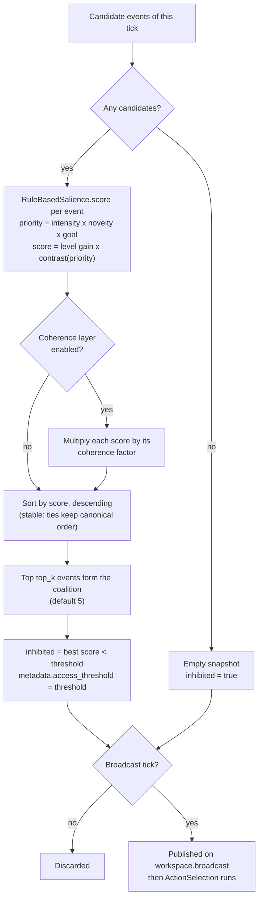

# The global workspace

The workspace module implements KAINE's global workspace. On every processing tick it scores the candidate events the active modules have published, ranks them, and forms a coalition. On a broadcast tick the cycle publishes that coalition, and the members whose scores reach the access threshold are the accessed content: they can drive report and action, and the perceptual and interoceptive processors adopt a summary of them as the context for their next predictions. This page documents the scoring formula and the access rule exactly as the code computes them, the broadcast payload, the prediction context built from it, the optional coherence layer, the held workspace-feedback extension, and how the action selection module turns an accessed broadcast into intents. Read it if you are tuning selection parameters, wiring a new module, or tracing why an event did or did not lead to speech.

Related: [The cognitive cycle](README.md) · [Architecture](../02-architecture/README.md) · [Configuration reference](../appendix-a-configuration/README.md)

## Selection pipeline

Every processing tick the cycle reads the events published since its previous read of each active module stream, sorts them by source, type and bus entry id (compared as the number pair milliseconds, sequence, which is arrival order within a stream; the stream breaks any remaining tie) so that a seeded run reproduces, names each candidate `<stream>:<entry_id>`, refreshes the affect snapshot the scorer reads, updates the access rate, and passes the list to `Workspace.select`. A bus entry id is unique only within its stream, and two streams can issue the same id in the same millisecond, so the stream-qualified name is what keeps one score per candidate in the score table. Selection runs on every processing tick. Only on a broadcast tick (the code's `is_experiential`) is the result published; on other ticks the candidates are scored and then discarded.



## Scoring

`kaine/workspace/salience.py` · `RuleBasedSalience.score`

Each candidate event `e` receives a priority and a score:

```
priority(e) = clamp(I(e) × N(e) × G(e))
score(e)    = clamp(T × C_g(priority(e)))
```

`clamp` maps to `[0, 1]`, and each of `I`, `N`, `G` and `T` is clamped to `[0, 1]` before the products are formed. The factors are:

| Symbol | Code | Value |
|---|---|---|
| `I(e)` | `event.salience` | The intensity the publishing module assigned when it published the event. The bus rejects values outside `[0, 1]`. |
| `N(e)` | `NoveltyTracker.observe` | `max(0, 1 − r / W)`, where `r` counts earlier occurrences of the event's fingerprint among the last `W` scored candidates and `W` is `[workspace].novelty_window` (32). The fingerprint is a hash of the source, the type and the complete payload, so only an exact repeat is discounted. Every scored candidate enters the window, on broadcast ticks and on other ticks alike. |
| `G(e)` | `GoalScorer.relevance` | 1 with the shipped static goal factor. See [The goal factor](#the-goal-factor). |
| `T` | `AffectModulator.modulate` | The level gain, `0.2 + 0.8 × a`, where `a` is the current Affect arousal. It is the same for every candidate of a tick. |
| `g` | `AffectModulator.contrast_gain` | The contrast gain, `arousal_contrast_gain × clamp((a − a0) / (1 − a0))`, with `a0` the baseline arousal (`[affect].baseline_arousal`, 0.3) and `[workspace].arousal_contrast_gain` 8.0. It is 0 at or below baseline arousal. |

`C_g` is the logistic rescaled so that it maps 0 to 0 and 1 to 1:

```
C_g(p) = (σ(g × (p − 0.5)) − σ(−g/2)) / (σ(g/2) − σ(−g/2))     for g > 0
C_0(p) = p
```

where `σ` is the logistic function. The code treats any gain at or below `1e-9` as 0. Above baseline arousal, priorities above one half are raised and priorities below one half are lowered.

If the scorer raises for an event, that event gets score 0 and a warning is logged.

With `[workspace].salience_affect_factor = "static"`, the affect module's factor is the constant 1 with contrast gain 0, so the score equals the priority. That setting is a negative control and logs a degraded-mode warning.

### What the formula does and does not do

The workspace applies no precision weight per source. The one per-source factor is emotion regulation's tier 1 (paper §3.5): when `[workspace].regulation_bias` is true and the affect module has named a source in a tier-1 `affect.regulation` event, every score of that source is multiplied by `1 - b`, with `b` decaying from 0.2 with a 20-entity-second time constant, and the workspace records `regulation_bias` (source, factor) in the broadcast metadata. Every workspace-mediation study arm turns `[workspace].regulation_bias` off, so there the ranking by intensity times novelty holds. Precision is local to each predictive processor: the vision, audition, interoception and sequence modules each divide their current prediction error by the mean of their own recent errors and report a graded intensity from that ratio (`kaine/modules/intensity.py`):

```
I = alert level                                              on a categorical alert
I = baseline + (alert level − baseline) × min(1, ratio / 2)  otherwise
```

So within a tick the processors' candidates compete on surprise measured against each channel's own history. A module's baseline and alert levels set the range over which its surprise is graded, which makes them per-source weights in effect. The affect, sleep and language modules publish at fixed levels. Every predictive processor's report payload carries a boolean `alert`.

Arousal is the global gain. Because `T` is common to every candidate and `C_g` is strictly increasing, and assuming no regulation bias is active, arousal never changes the order of the candidates within a tick. It moves the scores relative to the access threshold and the report bars, so it decides whether a broadcast is accessed and which of its members are, and it widens the gap between strong and weak candidates' scores. Arousal also sizes the sensory apertures (the vision module's fovea and the audition module's attended window), which changes what the processors report next.

With the shipped values, resting arousal (0.3) gives `T = 0.44` and `g = 0`, so a candidate reaches the threshold of 0.35 only when its priority is at least about 0.80. A priority below about 0.43 never reaches the threshold at any arousal. The intensity levels, the threshold and the report bars are provisional and are to be calibrated together on the live system before the planned runs; that calibration has not been done yet.

### The goal factor

`[workspace].salience_goal_factor` selects the goal factor. The shipped value, `"static"`, holds it at 1, and the boot logs an informational note.

The first-configuration profile selects `"interest"` (paper 3.5, A.1). Curiosity directs attention toward the source being learned, in proportion to its learning progress (Gottlieb et al. 2013; Poli et al. 2020):

```
G(e) = 1 + interest_gain × curiosity × lp+(src(e))
lp+(m) = max(0, lp_m − lp_0) / (1 − lp_0)
```

Here `lp_m` is module `m`'s own learning progress from the latest `affect.state` (`vision_learning_progress`, `audition_learning_progress`), `lp_0` is `[affect].learning_progress_floor`, and `interest_gain` (`gamma_I`, 0.5, calibrated) is `[workspace].interest_gain`. `G` is exactly 1 with no curiosity and for every source without learning progress (affect, sequence, interoception, language). It may exceed 1; only the priority is clipped. With full interest and a source's `lp+` of 0.5, the factor lifts that source's 0.7 alerts to the think bar at the tonic arousal a dominant drive sets (0.40 to 0.43). A processor whose errors are falling reports below its running mean, so without this factor it sits at its graded intensity floor. The factor emits no events, so nothing paces thought on a timer: thought follows the progressing source's own surprising reports and fades as the niche is learned. Every `config/studies/workspace_mediation_*.toml` sets the goal factor back to `"static"`, so the study arms rank by intensity and novelty alone.

The other alternative, `"drive_relevance"`, is built and off by default because it changes what reaches access. It reads the dominant affect module's drive `d` with value `v` and returns

```
G(e) = 1 − v × (1 − relevance(e)) × 0.5
```

where `relevance(e)` is 1 when the event's source relieves `d` and 0 otherwise, and `G = 1` when no drive is positive.

Each module class declares the drives its events relieve in `relieves_drives`. At boot `kaine/boot/wiring.py` builds the drive-to-source table from the registered modules' declarations, adds the action selection module (restlessness), and injects the table into the drive-relevance scorer, so the workspace never imports a module. A tag that is not one of the four drives (`curiosity`, `boredom`, `social_drive`, `restlessness`) fails the boot.

The live factors read affect, drives and per-source learning progress through an `AffectStateProvider` (`kaine/cycle/affect_state.py`), which the cycle refreshes each tick from the `affect.state` events it already collects. Scoring is a function of the event and that snapshot, with no wall-clock reads and no random numbers.

## Coalition and access

`kaine/workspace/core.py` · `Workspace._compose`

The workspace sorts the candidates by score in decreasing order. The sort is stable, so equal scores keep the canonical order by source, type and bus entry id. The first `[workspace].top_k` candidates (default 5) form the coalition. Then:

```
inhibited = best score < θ
metadata["access_threshold"] = θ
```

where `θ` is `[workspace].publication_threshold` (default 0.35), the access threshold. A coalition member is accessed when its own score reaches `θ` (a score equal to `θ` counts). A broadcast is accessed when at least one member is, which is the same as its best score reaching `θ`, so `inhibited` is false exactly when the broadcast is accessed. A member of an accessed broadcast whose score is below `θ` is broadcast but not accessed. With no candidates, the workspace returns an empty snapshot marked inhibited, whose metadata holds only the arm (the pooled arm below is the exception: its empty snapshot is not inhibited).

Every broadcast with candidates carries the threshold in its metadata so that each module can tell accessed members from the rest of the coalition. When the coherence layer is on, the threshold applies to the coherence-adjusted scores.

`workspace.set_publication_threshold(t)` changes the threshold at runtime; tests use it.

## The broadcast

On a broadcast tick the cycle publishes the snapshot to `workspace.broadcast` whatever its state: accessed, inhibited, or empty. The cycle then calls the action selection module. The payload has these fields:

| Field | Content |
|---|---|
| `tick_index` | The processing tick |
| `inhibited` | True when no member reached the threshold |
| `is_experiential` | True on a broadcast tick |
| `time_scale` | The entity clock's current multiple of wall-clock time |
| `salience_scores` | The score of every candidate of the tick, keyed by the candidate's id `<stream>:<entry_id>` |
| `metadata` | `access_threshold` (absent from an empty snapshot), `coherence` when the coherence layer is on, and `workspace_feedback` on an accessed broadcast when workspace feedback is on |
| `selected` | The coalition members in rank order, each with `entry_id` (the same `<stream>:<entry_id>` id that keys its score), `source`, `type`, `salience` (the reported intensity), `payload`, `timestamp` and `causal_parent` |

Only `source="workspace"` may publish to `workspace.broadcast`; any other source raises `ReservedStreamError`. Modules read the stream with `AsyncBus.subscribe_workspace_block`, advancing their own cursor.

How modules use the broadcast depends on its state:

| Reader | Accessed broadcast | Inhibited broadcast |
|---|---|---|
| Vision, Audition, Interoception | Adopt its accessed members as prediction context | Ignore it; the previous context stays |
| Sequence | Takes it as the input it predicts | Takes it as input too |
| Affect | Appraises it | Appraises it |
| Action selection | Applies the report rule | Derives no intent |

Because the sequence and affect modules read inhibited broadcasts, content that did not gain access can still influence later processing. The sleep module does not read the broadcast.

## The broadcast as prediction context

`kaine/modules/context.py` · `BroadcastContext`

The vision, audition and interoception modules each hold a `BroadcastContext`. When a broadcast arrives, `observe` adopts it only when it is not inhibited and at least one coalition member's score in `salience_scores` reaches `metadata["access_threshold"]`. The adopted members are exactly those accessed members, each weighted by its reported intensity (`salience`) rather than its score, so the context does not depend on the arousal gain. The context is held until the next adoption.

The context vector is a 24-component featurization of the adopted members plus the context's age:

| Index | Component |
|---|---|
| 0 | `log(1 + n)` for `n` members, capped at 8 |
| 1 to 3 | Mean, maximum and sample standard deviation of the members' intensities (the standard deviation is 0 for fewer than two members) |
| 4 to 11 | Intensity mass per source, in the order Interoception, Sequence, Vision, Planning, Episodic memory, Affect, Language, Effectors; any other source except Audition (Sleep, for example) adds to the Effectors component |
| 12 to 19 | Intensity mass in eight buckets chosen by a hash of `(source, type)`, an indicator of event types |
| 20 | `log(1 + age)`, the time in seconds since the module adopted the broadcast |
| 21 | Inhibition flag, always 0 for a context |
| 22 | Broadcast indicator, always 1 |
| 23 | Intensity mass of Audition |

The context records which modules' reports gained access, which event types, how strongly and how recently. It carries no payloads. Its age is the entity time since the broadcast was published: the cycle stamps each broadcast with `published_at` on the entity clock, and the vision, audition and interoception modules read the age on the same shared clock when they form a prediction. A broadcast without the stamp is aged from its receipt, and the age is never negative.

The context enters each processor's forward model as an extra input alongside the module's own recent inputs: the vision module's forward model, both audition module forward models (the acoustic path and the tone path), and the interoception module's readout. The weights that read the context are learned online with the rest of the model, so each processor learns how much the shared context helps it predict its own input. Before the first adoption the context input is all zeros. Adaptation pauses during sleep, as it does for the rest of each forward model. The sequence module does not hold a context; the broadcast is its input.

### Broadcast information gain per report

The vision module, the audition module's acoustic path and the interoception module also form a second prediction with a null context and publish, on every report, `context_gain`, the two errors it is computed from (`null_prediction_error` and `mean_prediction_error`), and `context_age_s`:

```
context_gain = (null error − error) / running mean error
```

The null context keeps the module's own share of the context and replaces the other sources' share with its mean over the contexts the module has adopted so far in the run. Components 0 to 3 are replaced by their running means, the additive components (4 to 19 and 23) by the kept sources' current share plus the mean of the other sources' share, and components 20 to 22 are kept. The context and its null are built from one reading of the clock, so they carry the same age. The kept sources are `vision` for the vision module, `audition` for the audition module, and `interoception` and `language` for the interoception module, because the language organ's load on the host would otherwise let its share predict the interoception module's input. The null prediction never trains the model. `context_gain` is `None` until a prediction formed with an adopted context has been scored.

This per-report gain is the measurement the planned workspace-mediation test is built on. The positive control that checks the measure detects injected information is built as a study-mode facility (`[positive_control]`, off by default). See [For researchers](../14-for-researchers.md#the-planned-test).

### The arms of the planned test

`[workspace].arm` selects the arm the live cycle runs (paper §6.3, A.8), and every broadcast records it in `metadata["arm"]`, which the research log copies.

- `competitive`, the default, is selection and access as described above.
- `matched` scores every candidate as usual, then on each broadcast tick draws `min(top_k, n)` of the `n` candidates uniformly without regard to score, from a generator seeded from the run seed (`[experiment].seed`). The drawn members are ordered by score. A drawn member is accessed when its score reaches `θ`, and the broadcast is inhibited when none does. Ticks that are not broadcast ticks draw nothing, so the same seed and the same broadcast ticks give the same coalitions. A matched selection whose context does not say whether the tick is a broadcast tick is refused. The generator's state is not saved: the draws reproduce within one uninterrupted run, and a restart or revive starts the stream again from the seed.
- `pooled` scores nothing. Every candidate of the tick is a member, the broadcast is never inhibited, the score table carries each candidate's intensity (the action selection module applies its report bars to intensities), and the metadata has no access threshold, so every member enters the context. An empty pooled broadcast replaces the context with the featurization of the empty set.

The two controls need the coherence layer off, as it is in the first configuration; the workspace refuses the combination at construction.

A run selects its arm through a study configuration, which also sets greedy decoding: `KAINE_STUDY=workspace_mediation_matched` (or `_competitive`, `_pooled`) applies `config/studies/workspace_mediation_matched.toml` after the operator file. See [How configuration is loaded](../appendix-a-configuration/README.md#how-configuration-is-loaded).

## Oscillatory coherence multiplier

`kaine/workspace/coherence.py`

The coherence layer is controlled by `[oscillator].enabled` and is off by default. When it is off, the workspace has no coherence scorer, selection skips the coherence step entirely, and no `metadata["coherence"]` is written.

When it is on, the cycle passes `context["phases"]` to the workspace each tick, a dict mapping module names to oscillator phase in radians, and the scorer appends each module's phase to a sliding window of `[oscillator].plv_window` samples (default 10, minimum 10).

### Phase-locking value

The PLV between two phase series of length `n` is

```
PLV(a, b) = | mean(exp(i × (a_k − b_k))) |
```

which lies in `[0, 1]`: 1 means perfectly phase-locked and values near 0 mean independent.

Only fresh samples count. A module's oscillator advances only when that module publishes, so between its events its phase is frozen. A sample is fresh when it is finite and differs from that module's previous sample, so a module's first sample is never fresh. A pair's PLV is computed over the window positions where both samples are fresh. A pair with fewer than three jointly fresh samples, and a source with no partner, takes the neutral PLV, the value that maps to a factor of exactly 1.

### Coherence factor

PLV maps linearly onto `[coherence_floor, coherence_ceiling]`:

```
factor = floor + (ceiling − floor) × PLV
```

The defaults are `coherence_floor = 0.8` and `coherence_ceiling = 1.25`, so the neutral PLV is `(1 − floor) / (ceiling − floor)`, about 0.444. For each candidate, `factor_for_source(source, cohort)` averages the PLV of the candidate's source with every other source present among the tick's candidates, and the candidate's score is multiplied by that factor. The product is not clipped again and can exceed 1, up to the ceiling. `metadata["coherence"]` holds the mean pairwise PLV over the sources of the tick's candidates, and the `CoherenceObserver` sidecar reads it.

### Validation controls

Two tests keep the toggle honest. With the layer disabled, an instance driven through many cycles with the same seed, events and phases as a baseline instance without a layer selects the same events in the same order, with the same scores and inhibition flag, and neither writes `metadata["coherence"]`. With the layer enabled at an extreme ceiling and floor, a phase-locked event with a lower raw score overtakes a desynchronized event with a higher one, which shows the layer is connected to selection.

## Workspace feedback (held extension)

`kaine/workspace/feedback.py`

Workspace feedback is a held extension (paper §3.2 "Workspace feedback (held extension)", §6.4). In the first configuration the workspace sends no error signal or directive back to any module. The extension adds two signals after the predictive global neuronal workspace (Whyte and Smith 2021; Whyte, Hohwy and Smith 2022) and the neuronal workspace model (Dehaene, Kerszberg and Changeux 1998). It ships off: `[workspace.feedback].enabled = false`; disabled, or with `arm = "off"`, no feedback object is built and every module and the workspace run the current code path unchanged.

### Top-down head and blend

`kaine/modules/feedback.py` · `TopDownBlend` · `TopDownHead`

Vision, audition's acoustic path (`audition.perception`; the tone path is unchanged) and interoception each wrap their forward model in a `TopDownBlend`. Its `TopDownHead` is a linear readout of the regressor (b, s, 1): the 24-component context b, the sequence module's predicted next broadcast featurization s (24 components, zeros before one is adopted) and a constant. It starts at zero and takes one stochastic-gradient step on the mean squared error per input at `head_learning_rate` (the forward models' eta_fm, 0.001), skipped while the forward model is suspended (sleep). The processor predicts with the blend of its own and the top-down prediction, each weighted by the inverse square of its running mean error over the last W_P = 32 scored errors (the module's prediction-error window); before the head has a scored error the blend is the own prediction. The reported error, error ratio, intensity, and for interoception the per-channel residuals that drive the unexpected error, are the blend's. The information-gain null error (paper A.8) is that of the blend formed with the null context b0 in both predictions and the same weights. A skipped non-finite input clears the blend. The heads are not preserved across boots.

With feedback on, the sequence module adds `predicted_next_feature_vector` (its forward-prediction head's prediction of the next broadcast featurization, 24 floats) to `sequence.report`. The workspace keeps the latest valid one it sees among the candidates of any tick.

### Gain

`kaine/workspace/feedback.py` · `FeedbackController`

Each processor's graded intensity uses `pi_j * ratio` in place of its error ratio, with `pi_j` the processor's gain carried by the latest accessed broadcast (1 before any). The categorical alert tests and the published `normalised_error` stay on the ungained ratio. The workspace keeps `pi_j` in `[pi_min, pi_max] = [0.8, 1.25]` (paper Table A1) with the mean over the three processors at one: gain moves only in equal and opposite steps of at most `gain_step`, clipped so both processors stay in bounds, and every gain relaxes toward one with time constant `gain_relax_s` in entity time, which keeps the mean at one.

### Conflict and the ablation arms

`kaine/boot/feedback.py`

The arms are `off` (the current build), `head_only`, `head_gain`, `full` and `matched_random`. A processor is in conflict when its highest-scoring accessed report carries a disagreement (the distance between its own and top-down predictions over its mean error) of at least `disagreement_threshold` and an error ratio of at least `conflict_error_ratio`, and it is not refractory. Resolution moves `gain_step` toward the other accessed processor with the lowest precision-weighted error (its gain times its error ratio) and away from the conflicting one; with no other accessed processor no gain moves. Each episode makes the conflicting processor refractory for `refractory_s`, so one episode per processor is in flight. In `matched_random` the same episodes move the same step between two distinct processors drawn by a generator seeded from the run seed, among the processors that have reported (all three until two have). The `head_gain` arm moves gain without the conflict test: on each accessed broadcast with at least two accessed processors, `gain_step` moves toward the lowest and away from the highest precision-weighted error, and the loser becomes refractory. This rule is a design choice; the paper names the arm but defines gain moves only through conflict resolution. The ablation runs on the harness of §6.3; its fail state is a full arm no better than the `matched_random` control. `KAINE_STUDY=workspace_feedback_<arm>` applies `config/studies/workspace_feedback_<arm>.toml`, which sets greedy decoding, `[workspace].arm = "competitive"` and `[workspace.feedback]` with `enabled = true` and the arm. The workspace-mediation study files are unchanged.

### What reaches the modules

Feedback never acts on an inhibited broadcast: the workspace attaches nothing and moves no gain (gains still relax with time), and the processors adopt nothing from one. On each accessed broadcast the workspace attaches `metadata["workspace_feedback"] = {"arm", "gains", "sequence_prediction", "episodes"}`; each episode is `{"kind": "conflict" | "precision" | "random", "conflicting", "toward", "away", "delta"}`. Each processor's report then carries `payload["workspace_feedback"] = {"disagreement", "error_ratio", "gain", "top_down_weight", "own_error", "top_down_error"}`. Feedback never changes the scores, ranking or access of a tick.

`make_workspace_feedback` refuses feedback with `[oscillator].enabled = true`, with `[workspace].arm` other than `"competitive"`, with `[positive_control].enabled = true`, and for `matched_random` without a run seed. The `Workspace` constructor refuses it with the coherence layer or a non-competitive arm, and the processors refuse it when their positive control is enabled.

## Action selection and the report rule

`kaine/workspace/action_selection.py` · `kaine/workspace/report_policy.py`

The cycle calls `ActionSelection.select(snapshot)` after each successful publication. The action selection module checks `inhibited` first and returns no intents for an inhibited broadcast. It is the only path from the workspace to an output; the cycle publishes the returned intents on `action_selection.out` and never calls an effector itself.

The policy is chosen by `[action_selection].policy` and `[action_selection].drive_initiative`:

| Setting | Policy |
|---|---|
| `policy = "self_initiated_report"` | `SelfInitiatedReportPolicy`, the first-configuration policy |
| no `policy`, `drive_initiative = true` (the code default) | `DriveBiasedActionSelectionPolicy` |
| no `policy`, `drive_initiative = false` | `DefaultActionSelectionPolicy` |

When the planning module is enabled, the composition root wraps whichever policy was chosen in `PlanningProposalSource` (`kaine/workspace/planning_proposals.py`), and the cycle publishes `action_selection.proposal_outcome` events on `action_selection_feedback.out` after the intents, including for inhibited broadcasts so that the planning module critic receives feedback. The `first_configuration` profile sets the self-initiated report policy with `drive_initiative = false`, and the planning module is off in that profile.

### The self-initiated report policy

`SelfInitiatedReportPolicy` derives intents from the workspace's own state and never from a user utterance. On an accessed broadcast it:

1. Clears the speak guard once the language organ has published external speech, and the think guard once it has published internal speech, whether or not that output is accessed (paper A.6 step 1). The cycle hands every organ speech event it reads from the bus to `ActionSelection.observe_own_output` on the tick it reads it, before selection, because at priority 0.4 the organ's utterances never reach access in the first configuration. A coalition that contains the organ's output also clears the matching guard. Either guard is also cleared after 48 seconds of wall time, so a failed realization cannot mute the entity.
2. Removes the language organ's own events (source `language`) from the coalition. If nothing is left, there is no intent. Otherwise the report signal is the highest score among the remaining members, and the signature is the `(source, type)` of that member.
3. Emits a `speak` intent when the signal reaches `report_threshold` (0.6), no speak is in flight, `speak_refractory_s` (8 entity seconds) has passed since the last speak, and the signature does not match the last spoken signature. A remembered signature stops blocking once it is older than `sig_expiry_s` (300 entity seconds in `first_configuration`; it never expires when unset).
4. Otherwise emits a `think` intent when the signal reaches `think_threshold` (0.45), no think is in flight, and `think_refractory_s` (3 entity seconds) has passed. The think path has no signature check.

At most one intent is emitted per broadcast. Both bars should sit above the access threshold, and the policy requires `0 ≤ think_threshold ≤ report_threshold ≤ 1`. An optional `interrupt_threshold`, strictly above `report_threshold`, lets a coalition with a different signature preempt a `speak` that is still in flight; it is unset by default.

The bars are a heuristic stand-in for the report-or-act decision of the predictive global neuronal workspace, which the action layer does not compute.

### The other policies

`DefaultActionSelectionPolicy` answers a user utterance: it emits one `speak` intent when the coalition holds an `audition.transcription` event with non-empty text. It never forms a `speak` about the entity's own external speech, and it keeps a one-in-flight guard that clears when the organ publishes the entity's own `external_speech`, accessed or not, or after 48 seconds of wall time.

`DriveBiasedActionSelectionPolicy` extends it: a `affect.drive` crossing in an accessed coalition becomes an intent. `social_drive` becomes `speak`, and a present user utterance always outranks it; `curiosity`, `boredom` and `restlessness` become `think`. `speak` and `think` have independent guards, each cleared by the organ's matching published output. When the planning module is enabled, `PlanningProposalSource` clears its own guard of that kind and passes the release on to the wrapped policy.

## Act intents and provenance

`kaine/security/intent_signing.py` · `kaine/modules/effectors/module.py`

All modules of a single-process instance share one bus credential, so the bus alone cannot prove which module published an event. For `act` intents, the only kind that can reach an effector, the composition root generates a per-boot secret (`generate_intent_secret()`, 32 random bytes held in process memory, never persisted or logged) and gives it to the action selection module and the effectors module.

The action selection module attaches a provenance envelope to every `act` intent: `run_id`, a per-signer monotonic `seq`, and `sig`, an HMAC-SHA256 over a canonical serialization of `(kind, effector, params, run_id, seq)`. `speak` and `think` intents carry no envelope. The effectors module verifies the signature with `verify_intent_signature` before it runs any effector and drops a forged, unsigned or replayed intent, recording it as `provenance_rejected`. The operator's effector whitelist applies after that check. The effectors module is held in the first configuration. See the [effectors module](../09-modules/effectors.md).

## Streams

| Stream | Direction | Events |
|---|---|---|
| `<module>.out` | module to bus | All module outputs |
| `workspace.broadcast` | cycle (as Workspace) to bus | `snapshot` JSON field, with no Event wrapper |
| `action_selection.out` | cycle to bus | `intent.speak`, `intent.think`, `intent.act`, `intent.rest` |
| `action_selection_feedback.out` | cycle to bus | `action_selection.proposal_outcome` |
| `cycle.control` | operator to bus | `cycle.set_rates` |
| `cycle.out` | cycle to bus | `cycle.tick`, `cycle.rates`, `cycle.time_scale` |

## Configuration reference

Selection keys live in `config/kaine.toml`; the `[action_selection]` values below are set by `config/profiles/first_configuration.toml` or are code defaults. See the [configuration reference](../appendix-a-configuration/README.md) for the full files.

| Key | Type | Default | Meaning |
|---|---|---|---|
| `[workspace].top_k` | int | 5 | Coalition capacity |
| `[workspace].publication_threshold` | float | 0.35 | The access threshold `θ` |
| `[workspace].novelty_window` | int | 32 | Novelty window `W`, in scored candidates |
| `[workspace].salience_affect_factor` | string | `"state_modulator"` | Arousal level and contrast gain; `"static"` is the negative control |
| `[workspace].salience_goal_factor` | string | `"static"` | Goal factor held at 1; `"interest"` (the first-configuration profile) raises learning sources; `"drive_relevance"` enables the drive-relevance scorer |
| `[workspace].interest_gain` | float | 0.5 | `gamma_I` of the interest goal factor |
| `[workspace].arousal_contrast_gain` | float | 8.0 | Contrast gain at arousal 1; 0 disables the contrast |
| `[workspace].arm` | string | `"competitive"` | Arm of the planned test: `"competitive"`, `"matched"` or `"pooled"` |
| `[workspace.feedback].enabled` | bool | `false` | Switch for workspace feedback |
| `[workspace.feedback].arm` | string | `"full"` | Ablation arm: `"off"`, `"head_only"`, `"head_gain"`, `"full"` or `"matched_random"` |
| `[workspace.feedback].pi_min` | float | `0.8` | Gain floor; paper Table A1, design value |
| `[workspace.feedback].pi_max` | float | `1.25` | Gain ceiling; paper Table A1, design value |
| `[workspace.feedback].disagreement_threshold` | float | `2.0` | Conflict disagreement threshold; design value, not fixed by the paper |
| `[workspace.feedback].conflict_error_ratio` | float | `2.0` | Error ratio at which a processor's error counts as high, by default the ratio at which intensity reaches the alert level; design value |
| `[workspace.feedback].gain_step` | float | `0.1` | Maximum equal-and-opposite gain move; design value |
| `[workspace.feedback].gain_relax_s` | float | `10.0` | Fast time constant for gain relaxation toward one, in entity seconds; design value |
| `[workspace.feedback].refractory_s` | float | `10.0` | Refractory period after an episode, in entity seconds; design value |
| `[workspace.feedback].head_learning_rate` | float | `0.001` | Top-down head stochastic-gradient step size, eta_fm; design value |
| `[affect].baseline_arousal` | float | 0.3 | Arousal at which the contrast gain is 0 |
| `[action_selection].policy` | string | unset; `"self_initiated_report"` in `first_configuration` | Action-selection policy |
| `[action_selection].drive_initiative` | bool | true; false in `first_configuration` | Use the drive-biased policy when no policy is named |
| `[action_selection].report_threshold` | float | 0.6 | Speak bar |
| `[action_selection].think_threshold` | float | 0.45 | Think bar |
| `[action_selection].interrupt_threshold` | float | unset | Optional interrupt bar, above the speak bar |
| `[action_selection].speak_refractory_s` | float | 8.0 | Minimum entity seconds between speak intents |
| `[action_selection].think_refractory_s` | float | 3.0 | Minimum entity seconds between think intents |
| `[action_selection].sig_expiry_s` | float | unset; 300.0 in `first_configuration` | Age at which a spoken signature stops blocking |
| `[oscillator].enabled` | bool | false | Coherence layer |
| `[oscillator].plv_window` | int | 10 | Phase window in ticks (minimum 10) |
| `[oscillator].coherence_floor` | float | 0.8 | Factor at PLV 0 |
| `[oscillator].coherence_ceiling` | float | 1.25 | Factor at PLV 1 |
| `[oscillator].population_size` | int | 16 | Spiking units per module oscillator (minimum 16) |
| `[oscillator].beta`, `threshold`, `base_drive` | float | 0.9, 1.0, 1.5 | Oscillator neuron parameters |

The level-gain floor and ceiling (0.2 and 1.0) are constructor defaults of `StateModulator` and have no config key. The access-rate keys are on [The cognitive cycle](README.md#adaptive-access-rate) page.

## Persistence

- `CoherenceScorer` phase windows live in memory only and start again from the neutral phase after a restart.
- `WorkspaceSnapshot` objects are not persisted. The `workspace.broadcast` stream holds the serialized payload and is trimmed to 100,000 entries by approximate `MAXLEN` (`[bus.per_stream_maxlen]`, applied in `kaine/bus/client.py`).
- A `BroadcastContext` is held in memory; after a restart a processor starts with no context until the next accessed broadcast.

## Key files

| File | Role |
|------|------|
| `kaine/workspace/core.py` | `Workspace`: scoring loop, coalition, access threshold |
| `kaine/workspace/salience.py` | `RuleBasedSalience`, `arousal_contrast` |
| `kaine/workspace/novelty.py` | `NoveltyTracker`, the event fingerprint |
| `kaine/workspace/strategies.py` | `GoalScorer` and `AffectModulator` protocols, static factors, `DriveRelevanceGoalScorer` |
| `kaine/modules/affect/modulator.py` | `StateModulator`, the live level and contrast gain |
| `kaine/modules/intensity.py` | `graded_intensity`, shared by the predictive processors |
| `kaine/modules/context.py` | `BroadcastContext`, the context featurization and null context |
| `kaine/workspace/coherence.py` | `CoherenceScorer`, `phase_locking_value`, `mean_pairwise_plv` |
| `kaine/workspace/feedback.py` | `FeedbackController`, settings |
| `kaine/modules/feedback.py` | `TopDownHead`, `TopDownBlend`, `FeedbackChannel` |
| `kaine/boot/feedback.py` | Workspace feedback boot helpers |
| `tests/test_workspace_feedback_*.py` | Workspace feedback tests |
| `kaine/workspace/action_selection.py` | `ActionSelection`, `DefaultActionSelectionPolicy`, `Intent` |
| `kaine/workspace/report_policy.py` | `SelfInitiatedReportPolicy` |
| `kaine/workspace/drive_policy.py` | `DriveBiasedActionSelectionPolicy` |
| `kaine/workspace/planning_proposals.py` | `PlanningProposalSource`, used when Planning is enabled |
| `kaine/security/intent_signing.py` | `IntentSigner`, `generate_intent_secret`, `verify_intent_signature` |
| `kaine/cycle/types.py` | `WorkspaceSnapshot` |
| `kaine/cycle/affect_state.py` | `AffectStateProvider` |
| `kaine/boot/wiring.py` | Builds the salience factors and the drive-to-source table |
| `kaine/cycle/__main__.py` | Composition root that wires the policy, Action selection and signing |
