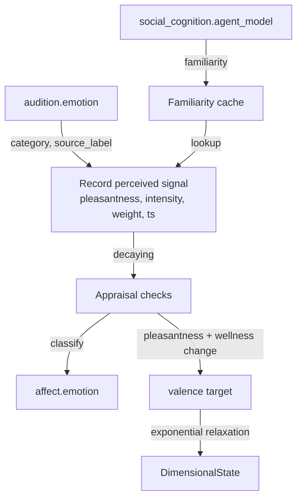

# Affect

The affect module is the affective core. It holds a dimensional state of valence, arousal and dominance, runs an appraisal of every workspace broadcast, and keeps four homeostatic drives. Its arousal is the global gain on the workspace competition. Read this page if you enable the module, run the `first_configuration` profile, or need to know what moves arousal and valence and what the sleep module resets.

The affect module ships disabled in the default config (`[modules].affect = false` in `config/kaine.toml`). The `first_configuration` profile enables it, because a global gain that sets how readily content gains access, and that surprise itself moves, belongs to the minimal machinery of the first configuration. It needs nothing beyond the core stack.

## Arousal: the global gain and contrast

Every predictive processor scales its own prediction error by its recent errors (local precision). Arousal adds one gain across all of them, following the adaptive-gain account of locus coeruleus function. The workspace computes each candidate's priority as `p = clip(intensity × novelty × goal, 0, 1)`, with the goal factor held at 1 by default (`[workspace].salience_goal_factor = "static"`), and turns it into a score with two arousal terms:

```
T = 0.2 + 0.8 × a                                 level gain, common to every candidate
g = g_max × clip((a - a0) / (1 - a0), 0, 1)       contrast gain, zero at or below baseline
score = T × C_g(p)
```

`a` is arousal, `a0` is `[affect].baseline_arousal` (0.3), and `g_max` is `[workspace].arousal_contrast_gain` (8.0). `C_g` is a logistic in the priority, rescaled so that it fixes 0 and 1 and reduces to the identity at `g = 0`. Because the level gain is shared and `C_g` is strictly increasing, arousal never reorders the candidates of a tick. It moves the best score relative to the access threshold and the report bars, it decides which members of a coalition reach the threshold, and it widens the gap between the scores of strong and weak candidates.

Arousal also sizes the sensory apertures. The vision module narrows its fovea and the audition module shortens its attended window as arousal rises. Tonic arousal raises the access rate as well (see [The cognitive cycle](../08-cognitive-cycle/README.md)).

The cycle reads arousal from the latest `affect.state` event it has collected, through `AffectStateProvider` (`kaine/cycle/affect_state.py`), which starts at the baseline before the first event. The workspace gain, the fovea, the auditory window and the access rate therefore see arousal as it stood at the affect module's last state publication, up to one `publish_interval_s` old.

### What moves arousal

The appraisal of a broadcast does not move arousal, so a higher access rate cannot feed back into it. Arousal rises on three paths, all read directly from the producing modules' streams whether or not the report wins access:

| Source | Condition | Change in arousal |
|---|---|---|
| `vision.report`, `audition.perception` | `alert: true` | `+0.15 × h × min(4, max(0, max(r, c) - 1))`, with `r` the report's `normalised_error` (its error over its running mean), `c` its `normalised_change` (its change score over its running mean) and `h` the habituation factor below |
| `interoception.report` | non-empty `alerts` list (a host metric past its hard limit) | `+0.05` |
| `episodic_memory.recall` | `max_affect_intensity > 0` | `+0.05 × max_affect_intensity` (the episodic memory module is held in the first configuration) |

A missing, non-numeric or non-finite ratio counts as 0, so a report without `normalised_change` raises arousal by its error ratio alone, and an alert whose ratios are both at most 1 leaves arousal unchanged. The habituation factor is `h = max(clip(r_fast / max(r_slow, 0.05) - 1, 0, 1), exp(-r_slow × slow_time_constant_s))`, read from the alert rates before this alert adds to them (paper A.4 item 1). `r_slow × slow_time_constant_s` is the expected count of recent alerts, so the presentation term `exp(-r_slow × 100)` is the chance of none: 1 for the first alert after a quiet spell, about 0.37 after one presentation, near 0 at a steady base rate, and it recovers as `r_slow` decays (to 0.5 about five minutes after a dense stream stops). Locus coeruleus cells respond fully to the first presentations of a stimulus and the response then decrements, markedly from the second encounter (Hervé-Minvielle and Sara 1995; Vankov, Hervé-Minvielle and Sara 1995). The burst term, the boredom drive's alert-rate excess without its margin, keeps alerts that arrive faster than the habituated rate arousing. The self-calibrating alert criteria make even a still scene alert at a steady base rate, and those alerts leave arousal near baseline. In the 2026-10-17 test boot, whose stimulus produced a pair of change alerts about every 15 s, a replay of the recorded alerts put settled arousal at a median of 0.86 without the factor and 0.35 with it. The change ratio follows paper A.5: the locus coeruleus responds phasically to salient abrupt change as well as to unexpected outcomes (Bouret and Richmond 2009), and most vision alerts are change alerts whose error ratio sits near 1. Between these nudges dominance relaxes toward its baseline and arousal toward a target that the most pressing drive raises (paper A.4 item 3): at each update `a <- a + (a_inf - a) × min(1, drift_rate_per_s × dt)` with `a_inf = a0 + drive_arousal_gain × (1 - a0) × v*`, where `v*` is the largest drive value at the start of the update. The time constant is 20 entity seconds at the default rate. Arousal is clipped to `[0, 1]`.

The tonic target follows two accounts. Tonic locus coeruleus activity rises when the utility of the current engagement wanes, driving disengagement and exploration (Aston-Jones and Cohen 2005). Drive energizes learned responses generally (Hull 1943). A drive deficit is the sustained absence of the reward its relief would bring, so the largest one stands for that waning utility. Without the target, a habituated entity in a steady scene sits at `a0` with its drives near 0.9. There only audition alerts reach access (paper A.11), and the 2026-10-17 third test boot had 0 to 3 accessed broadcasts a minute for 17 of its 41 minutes. With the default gain 0.2, a dominant drive between its threshold (0.7) and its deprived level (0.9) puts the target at 0.40 to 0.43. That is above the arousal of about 0.37 that vision, sequence, interoception and affect alerts need to reach the access threshold, and below the 0.45 at which an audition alert reaches the think bar, so reports still need a phasic step. A satisfied entity (`v*` = 0) rests at `a0`. The sleep reset sets every drive to 0, so the target is `a0` right after sleep. A replay of both 2026-10-17 boots put arousal at or above 0.37 for 99% of the time with the gain (55 to 58% without it) and at or above the speak bar of 0.63 for 31 to 35% (23 to 26% without it). Access feeds back: intents relieve restlessness and, unless about a drive, boredom, and lower `v*` when one of them is the largest drive. In a monotonous scene without such intents boredom falls only with alert excess and holds the target up until sleep. The workspace contrast gain and the regulation intensity keep `a0` as their reference.

## Valence from error dynamics

Valence follows error dynamics, how fast the entity's prediction errors fall or rise, so a steady state is neutral: valence as the negative rate of change of free energy (Joffily and Coricelli 2013), positive while errors fall and negative while they rise (Van de Cruys 2017; Kiverstein, Miller and Rietveld 2019). For each perceptual source (the vision module and the audition module's acoustic path) the affect module keeps a fast and a slow time-decayed mean of the raw `prediction_error` its reports carry, counting from the source's first positive error:

```
S <- d*S + e,  N <- d*N + 1,  E = S / N,  d = exp(-dt / tau)
       tau = fast_time_constant_s (10) or slow_time_constant_s (100)
g        = mean over sources of clip((E_slow - E_fast) / E_slow, -1, 1)
pl       = clip(tanh(valence_progress_gain * g) + coupling, -1, 1)
W_fast, W_slow = time-decayed means of the reported wellness (same tau values)
v_target = clip(pl + W_fast - W_slow, -1, 1)
valence += (v_target - valence) * (1 - exp(-dt / valence_time_constant_s))
```

Falling errors make `g` positive and pull valence up; rising errors make it negative. `pl` is the appraisal's pleasantness check, and `coupling` is the perceived-emotion term described under [Affect coupling](#affect-coupling), zero in the first configuration. Wellness enters as its change, the dynamics of the homeostatic error: a dip in host headroom pulls valence down and its recovery pulls it up, while a steady host, healthy or not, adds nothing. `W_fast - W_slow` is 0 before the first wellness report. The wellness means carry through sleep and persist with the error means. Early on the fast and slow means are both close to the plain mean of the samples so far, so `g` starts near zero.

`[affect].valence_rule` selects the rule. `"error_dynamics"` (the default) is the rule above. `"wellness_level"` keeps the earlier rule, `v_target = clip(pl + (wellness - 0.5), -1, 1)` with the last reported wellness (0.5 before any), and then the module behaves bit for bit as before: it neither updates nor stores the wellness means. In the fourth test boot (2026-10-17) the earlier rule held valence near +0.38 for the whole run on a healthy host (wellness near 0.88) and it never went below 0. A replay estimate of the error-dynamics rule over the same run puts valence at a median of +0.01 (5th to 95th percentile -0.03 to +0.04), below 0 for 28% of the time and never below -0.12.

## Drives

Each drive is a deficit in `[0, 1]` that builds while its need goes unmet and is reduced by the events that meet it, the reduction serving as the drive's reward (Hull 1943; Keramati and Gutkin 2014). Between updates a drive follows the exact solution of `dD/dt = build_rate × u × (1 - D) - decay_rate × D`, so it relaxes toward `build_rate × u / (build_rate × u + decay_rate)` at a rate that does not depend on how often the affect module updates. Each default decay rate is about a ninth of its build rate, so a fully deprived drive settles near 0.9, above its 0.7 threshold.

Relief comes in two forms. Curiosity and boredom are relieved continuously, `D <- D × exp(-relief_gain × c × dt)`, so the amount relieved does not depend on how often the perceptual modules report. The social drive and restlessness are relieved per event, `D <- D × (1 - relief_gain × c)`. Boredom also has a per-event channel, engagement: each action selection intent other than `intent.rest` removes `boredom_engagement_relief` (rho_eng, default 0.5) of its value, `D <- D × (1 - rho_eng)`, unless the intent is about a drive: its `about_kind` is `felt` (a drive's felt-state phrase), or its `entry_id` names one of the module's own `affect.drive` crossing events (the first-configuration report policy labels every intent `event` and names the coalition's leading member). The module keeps the bus entry ids of its last 256 crossing and re-entry events for this check; they are transient, so an intent about a [re-entry](#sustained-concern-re-entry) is also about a drive.

| Drive | Builds with `u` | Relieved by | Grounding |
|---|---|---|---|
| `curiosity` | `1 - LP` | continuously, `c = LP` | learning progress (Oudeyer and Kaplan 2007; Schmidhuber 2010) |
| `boredom` | `1 - N` | continuously, `c = N`; and each intent other than `intent.rest` not about a drive, by `boredom_engagement_relief` | a failure to engage attention (Eastwood et al. 2012) or meaning (Westgate and Wilson 2018), met by novelty and by the re-engagement it motivates (Bench and Lench 2013) |
| `social_drive` | `1` once the entity has heard a voice, else `0` | each new voice, `c = 1` | social homeostasis (Matthews and Tye 2019) |
| `restlessness` | `1 - intent_rate` | each action selection module intent other than `intent.rest`, `c = 1` | a design choice with no established model behind it |

Boredom is the failure to engage attention with internal or external information (Eastwood et al. 2012) or with valued activity (Westgate and Wilson 2018), and it motivates the pursuit of new goals and experiences (Bench and Lench 2013, 2019). Re-engagement is therefore the entity's own response to it, and the engagement channel is credited as own; novelty that arrives by itself is not. Without the channel every boredom crossing ended as not the entity's own response (in the fourth 2026-10-17 test boot, 8 of 8 boredom goals that ended by a fall were abandoned without response), so coping learned that boredom is uncontrollable, the structure of learned helplessness (Maier and Seligman 2016). Self-generated thought as such does not count: thinking alone is unpleasant and less engaging than mundane activity (Wilson et al. 2014; Westgate, Wilson and Gilbert 2017), and noticing one's failure to engage is part of boredom itself (Eastwood et al. 2012). So an intent about a drive, such as the think or report intent a boredom crossing that reached access itself produces, does not relieve boredom; intents about perceived, heard or other content do.

`LP = max(0, g - learning_progress_floor) / (1 - learning_progress_floor)` is learning progress above a noise floor, so rectified noise in `g` does not relieve curiosity on a scene where nothing is being learned. `N = clip(r_fast / max(r_slow, 0.05) - 1 - alert_excess_margin, 0, 1)` is the novelty of the alert stream. Each perceptual alert raises the fast rate `r_fast` by `1 / fast_time_constant_s` and the slow rate `r_slow` by `1 / slow_time_constant_s`, and both decay with their own time constant. The alert criterion is self-calibrating, so even a still scene alerts at a steady base rate, and only alerts in excess of that habituated rate relieve boredom.

The social drive reads the sequence module. The sequence module counts an interaction when a tone-of-voice or transcription event arrives from a live source (`live_mic`, `microphone` or `remote`). The first finite `time_since_last_interaction_s` in a `sequence.report` starts the drive building, and each later drop in that value relieves it. The intent rate is an exponential average updated on every broadcast, `r <- r + intent_rate_weight × (min(1, n) - r)`, with `n` the number of non-rest intents since the previous broadcast.

A drive that crosses its threshold publishes one `affect.drive` event and re-arms only after it falls below 0.9 of the threshold.

## Appraisal

On every broadcast, accessed or inhibited, the affect module first updates its state and drives and then scores the broadcast coalition on the five checks of Scherer's component process model:

| Check | Computation |
|---|---|
| Novelty | `1 - prod(1 - s)` over coalition members that carry a positive `normalised_error` or `normalised_change`, with `s = clip(ln ρ / ln 3, 0, 1)` for the larger ratio `ρ` (a ratio of 2.2 gives 0.72), multiplied by the habituation factor `h` at the appraisal for `vision.report` and `audition.perception` members; 0 when no member carries a ratio. The change ratio covers suddenness, the error ratio predictability and `h` familiarity (Sander, Grandjean and Scherer 2005; paper A.4) |
| Intrinsic pleasantness | `pl`, the learning-progress term above |
| Goal significance | the conducive part `r` minus the obstruction `o`, clipped to `[-1, 1]` |
| Coping potential | `2p - 1`, only when goal significance is nonzero (below) |
| Norm compatibility | fixed at `0.0` and unavailable, since KAINE has no standards until an operator writes a list; no categorical rule reads it |

The cycle injects a drive-to-source table built from each registered module's `relieves_drives` declaration. With dominant drive value `v > 0` and `f` the intensity-weighted share of coalition members whose source relieves that drive, the drive score is `v × f`: `v` when every member serves the drive and `0` when none does (irrelevant, per Scherer's relevance check). With no drive above zero the score is `0.0`. When the `GoalLedger` holds active goals, their token-overlap `relevance` in `[0, 1]` is also computed and the check takes the larger of the two. The conducive part `r` is in `[0, 1]` and the obstruction below can make the goal score negative, and drive crossings fill the ledger. The goal score feeds the categorical emotion and does not enter selection directly, where the goal factor is held constant; it reaches selection only through emotion regulation's tier-1 attentional deployment.

Coping potential is checked whenever goal significance is nonzero, negative included. At exactly 0 the content is irrelevant and coping is unavailable: `coping_available` is false in `affect.emotion`, and fear, anger and sadness are not eligible. Otherwise `p = (s + 1) / (s + f + 2)`. When the drive term sets goal significance (also on a tie), `s` counts the dominant drive's crossings that the entity's own response ended (fell below the re-arm band): learning progress for curiosity, intents for restlessness, and engaging intents for boredom, by relief or by holding the build input down, the latter only when a counterfactual step at the no-response input would not have fallen back. `f` counts every other end: decay alone, novelty for boredom, another's voice for the social drive. When the ledger sets it, `s` and `f` are completed and abandoned goals. Coping is `2p - 1`, so `0.0` before any history. Arousal and valence do not enter it. A sleep reset counts as neither. (Paper A.4; Sander, Grandjean and Scherer 2005; Maier and Seligman 2016; Williams et al. 2015).

`goal_significance_method` in each `affect.emotion` event records how the check was computed:

| Method | Meaning |
|---|---|
| `drive_relevance_v1` | Scored against the dominant drive |
| `drive_relevance_v1+token_overlap_v1` | Drive score and active ledger goals both computed; the larger is used |
| `token_overlap_v1` | No drive-to-source table was injected, and active ledger goals were scored |
| `unavailable` | Neither exists; the score is `0.0` |

## Goals and obstruction

(Paper A.4, "Goals." and "Obstruction.") A crossing of a drive threshold creates the goal of relieving that drive. The goal description is `relieve <drive>` and its priority is the drive value at the crossing, unless that drive already has an active goal. Intents are responses to goals, not sources of goals; only a drive crossing or an explicit `add_goal` call creates a goal. Each drive goal carries an expected-relief likelihood `L` in `[0, 1]`, set at creation to the drive's success ratio `p = (s + 1) / (s + f + 2)`. The same own-response and other-response counts that set coping potential also set `p`; `s` counts crossings ended by the entity's own response and `f` counts crossings ended otherwise.

A goal ends in one of four ways:

| End | Condition | Outcome |
|---|---|---|
| Completed | The drive falls below 0.9 of its threshold and the credit rule counts the fall as the entity's own response | The goal ends as completed and the completed count rises |
| Abandoned (another's response) | The drive falls below the re-arm band but the credit rule counts the fall as another's response | The goal ends as abandoned and the abandoned count rises |
| Abandoned (stalled) | The drive stays at or above its threshold for `goal_stall_s` (600 entity s) without a dip below the threshold restarting the timer | The goal ends as abandoned and the abandoned count rises |
| Abandoned (cap) | Active goals exceed `goal_cap` (3) and this goal has the lowest priority, with ties broken by earliest creation | The goal ends as abandoned and the abandoned count rises |

Goals added through `add_goal` count toward the cap. When a drive goal is active, the ledger is active and the token-overlap term is computed alongside the drive term; the appraisal method is then `drive_relevance_v1+token_overlap_v1`. With no goal active the appraisal is as before.

While a drive goal is active, every non-rest intent opens a response window of `goal_response_window_s` (10 entity s) against the drive's value just before the intent. The window checks whether the drive has dropped below that value by the first update at or after the window ends. If it has not, the expected-relief likelihood falls by `ΔL = goal_likelihood_fall × L` (default 0.5) and `ΔL` is held for the next appraisal. If several windows close before the next appraisal, their held `ΔL` values are summed. The next appraisal takes the obstruction `o = v* × ΔL` from the dominant drive's active goal, where `v*` is the dominant drive's value at appraisal time and `ΔL` is the held likelihood fall; if there is no held `ΔL` then `o = 0`. After the appraisal every held `ΔL` is cleared. The goal score is `clip(r - o, -1, 1)`, where `r` is the conducive part (the larger of the drive score and the ledger relevance). With no injected drive table there is no dominant drive and `o = 0`.

Coping is checked whenever the goal score is nonzero, negative included, and is unavailable only at exactly 0. The term that supplies `r` also supplies `p` for coping; on a tie between the drive term and ledger relevance the drive term supplies `p`.

Every lifecycle change publishes `affect.goal`: `added` carries `drive` and `likelihood`; `completed` and `abandoned` carry `drive` and `reason`, with reasons `own_response`, `without_response`, `stalled` and `cap`; `cleared` carries `drive` and the reason `sleep_reset` (see [Sleep reset](#sleep-reset)).

### Sustained-concern re-entry

(Paper 3.5 and A.4, "Goals.") An active goal is a current concern, which keeps cueing thought until met or dropped (Klinger 1975, 2013), and a cue the cycle discards has cued no thought, so the re-entry interval runs between the times the concern is accessed. While a goal is active and its drive `D` is at or above its threshold, its drive event recurs on each of the module's own `publish_interval_s` updates (`P_Aff`, default 1 entity s) until a broadcast accesses it, then `concern_reentry_s` (`P_re`, default 30 entity s) after that access. Each recurrence is an `affect.drive` event with payload `{"drive", "value", "alert": false, "reentry": true}` and intensity `D`.

The goal's latest drive event is its pending event: first the crossing that created it, published on whatever update detects it, then each re-entry. On every broadcast it receives, before its update, the module checks the coalition: a member is accessed when the broadcast is not inhibited and the member scores at or above the broadcast's `access_threshold` (without a threshold, coalition membership in a broadcast that is not inhibited suffices), as for the perceptual modules' context. An accessed member that is one of the module's own drive events for the goal's drive (its key names `affect.out` and an entry id among the recent drive entry ids) ends the pending event, including an earlier copy accessed late, and the next re-entry is due `P_re` after that update. Candidates only in the score table, members under the threshold, members of an inhibited broadcast and keys from other streams leave it pending.

Only the module's own timer updates publish re-entries. An event published on the update that follows a broadcast is read by the cycle's next tick, which broadcasts only when the access rate exceeds half the processing rate (the access accumulator), so most such events are scored and discarded; the timer runs on the module's own clock and its updates fall at any phase of the cycle. On a timer update a pending event is republished once the previous copy is at least half of `P_Aff` old, which keeps a copy the cycle has not read yet from being duplicated on the bus, and a goal without one publishes its re-entry once due. At most one copy per goal per update. A drive below its threshold publishes nothing and keeps its pending event or due time. A goal that ends, stalls, is capped or is cleared by the sleep reset loses its pending event and due time, and both are transient: after a restore the first re-entry of a restored goal is due `P_re` after the first update that sees it.

A re-entry is not a categorical alert, so it raises neither the phasic access drive (A.3) nor arousal; it competes through the ordinary score, novelty factor and A.6 guards like any candidate, and a copy read on a tick that does not broadcast is discarded like any other candidate, then repeated. Its intensity `D` makes a more pressing concern more salient: at the tonic arousal target of a deprived entity (about 0.426 with `v*` 0.9) a re-entry at `D` 0.7 scores about 0.38, accessed but under the think bar 0.45, and one at the deprived level 0.9 scores about 0.49, which reaches thought. The tonic arousal target itself is unchanged. An intent about a re-entry is about a drive, so it does not relieve boredom (see [Drives](#drives)); like every intent other than rest it relieves restlessness and opens response windows. The bound on the rate is `goal_cap / P_Aff` copies while concerns go unaccessed and `goal_cap / P_re` accessed re-entries, and the stall horizon ends a concern that never falls, the disengagement that follows a blocked goal (Klinger 1975; Wrosch et al. 2003).

In the fifth test boot (2026-10-17, main 307b374d) intents per 10-minute window fell 61 / 33 / 14 / 1 and an 8-minute restart had none, while curiosity, boredom and restlessness sat at 0.9 with their goals active: only 2 drive crossings reached thought in 40 minutes. A replay of that boot's broadcast, affect and goal logs through the rule (curiosity, boredom and arousal as logged, restlessness simulated) gives 77 / 37 / 24 / 13 intents per window and 18 in the restart, most of the added ones about a drive. In the sixth test boot (2026-10-18, main 7b5ed07c) the first form of the rule, a re-entry every `P_re` after the crossing or the previous re-entry, published 237 re-entries at 30 s spacing, but only 36 (15%) were ever candidates on a broadcast tick, against 25% of crossings and about 49% of affect state, vision and audition events, and seven silences of 141 to 262 s remained with curiosity and boredom at 0.83 to 0.90. A replay of that boot's tick, broadcast, affect state and goal logs (the same model, which reproduces the measured 49% and 25%) gives under the present rule 98% of concern episodes accessed, at 50% of the published copies and a median 0.8 s after publication, and no silence over 120 s (longest 89 s, against 9 over 120 s for the first form). Publishing re-entries only from the timer without repeating them reaches 36% and leaves six silences over 120 s; repeating on every update, broadcast updates included, reaches the workspace at about six copies per access.

`concern_reentry_s = 0` turns re-entry off: no pending state, no access check and no re-entry, so the module behaves bit for bit as before.

A rule-based `classify()` maps the five scores to `joy`, `sadness`, `anger`, `fear`, `surprise`, `disgust` or `neutral`, and the affect module publishes `affect.emotion` when the category changes. The rules are modeled on the predicted appraisal profiles of Sander, Grandjean and Scherer (2005, Table 3). KAINE has a single novelty check that covers suddenness, familiarity and predictability together, so Table 3's low familiarity maps to high novelty here: a report the processor did not expect is unfamiliar to it. Surprise is reachable when the coalition carries a strongly surprising report and pleasantness and goal significance are near zero. Fear follows Table 3's fear profile: the content must be relevant (coping available, so the goal score is nonzero), pleasantness at or below -0.3 (low), novelty above 0.3 (low familiarity) and coping at or below -0.3 (very low power). Near-neutral unpleasantness therefore no longer gives fear. The goal score does not gate fear. Table 3 pairs fear's Obstruct with high outcome probability and very high urgency, that is an anticipated obstruction (a threat). KAINE's goal score measures present conduciveness, and its obstruction term is retrospective (an unanswered response), so it cannot represent an anticipated obstruction. Fear is reachable whenever relevant, unpleasant, unfamiliar content meets a poor own-response record, for example a dominant drive whose crossings mostly ended without the entity's response, or a ledger with mostly abandoned goals. Disgust is returned when pleasantness is at or below -0.5, novelty is above 0.3 and the absolute goal score is below 0.3; it is checked after fear and anger (which require coping potential) and before sadness. Table 3 leaves the standards check open for disgust, and very low standards would mark contempt, which KAINE does not classify. Anger needs a goal score at or below -0.3 and coping at least 0.3, which obstruction of a goal with a strong own-response history supplies; it matches at best Table 3's irritation profile, because Table 3's rage profile needs the obstruction attributed to another agent, which KAINE does not do, and the irritation profile's standards check is also missing.

## Emotion regulation

Emotion regulation follows the process model of Gross (1998) and is configured under `[affect.regulation]` (paper §3.5).

`policy = "three_tier"` runs a monitor that escalates through three tiers while a negative affective episode lasts. `policy = "passive"` keeps the previous no-op `PassiveDecay` and is the off arm; it emits no `affect.regulation` events and behaves as before regulation was added.

At every affect update the monitor computes episode intensity `max(|v|, a - a0)`, where `v` is valence and `a0` is `[affect].baseline_arousal`. The last appraisal counts as negative when its pleasantness or goal score is below 0. An episode begins at the first update whose intensity is at or above `set_point` (0.5) and whose appraisal is negative, and ends at the first update that lacks both. After `Δst` entity seconds inside an episode, each increase of `floor(Δst / sustain_window_s)` that is at least 1 fires one activation of tier `min(floor(Δst / sustain_window_s), 3)`. This implements A.5's rule; `sustain_window_s` (30 s) serves as the regulation `Δ_R` because Table A1 gives emotion regulation no window of its own. With the defaults, tier 1 fires at 30 s, tier 2 at 60 s, tier 3 at 90 s, and tier 3 fires again every 30 s while the episode lasts.

The three tiers are:

| Tier | Action | What it does |
|---|---|---|
| 1 | `attentional_deployment` | During the episode the monitor sums, per source, the intensity of the members of each negatively appraised coalition, starting with the coalition whose appraisal began the episode. It names the source with the largest mass (ties to the alphabetically first source), with `bias` `selection_bias` (0.2) and `decay_s` `bias_decay_s` (20 s). |
| 2 | `reappraisal` | Once per episode the module re-runs the appraisal of the last broadcast against the current coping and goal state, classifies the result and replaces the categorical emotion with it, publishing `affect.emotion` with `reappraised: true` when the emotion changes. Valence, arousal and dominance are unchanged: the emotion is what appraisal sets. |
| 3 | `request_maintenance` | The module publishes `action: "request_maintenance"`. The sleep module's maintenance consumer starts a sleep on it under the same guards as the interoception module's maintenance request (only when `[sleep.consolidation].fatigue_triggered = true`). The sleep's affective reset is the backstop, and the reset ends any regulation episode. |

For tier 1, the workspace is what applies the bias. When `[workspace].regulation_bias` is true (the default) and the affect module has named a source, the workspace multiplies every score `S'` of that source by `1 - b`, where `b = b_E exp(-(t - t1) / tau_E)` from the cycle tick that collects the event, `b_E` is `selection_bias` and `tau_E` is `bias_decay_s`. It records `regulation_bias` (source, factor) in the broadcast metadata. If there is no negatively appraised coalition member the tier-1 activation names no source and the bias is 0. Every workspace-mediation study arm sets `[workspace].regulation_bias` to false, so the score ranking there is unaffected. The affective reset's `affect.state` event (`reset: true`) clears the bias.

For tier 2, coping and the goal score can have changed since the broadcast was first appraised (a goal ended, its likelihood fell, a drive's success record grew), so the re-run can turn, for example, fear into another emotion once coping has improved.

Every tier activation publishes one `affect.regulation` event on `affect.out` at `baseline_salience`, carrying `tier`, `action` (`attentional_deployment`, `reappraisal` or `request_maintenance`), `intensity`, `episode_s` and `size`: for tier 1 the bias value, for tier 2 `1` if the emotion changed and `0` otherwise, with `emotion_before` and `emotion_after`, and for tier 3 the intensity. The event is logged at info level.

Emotion regulation is off during the developmental phase. The cycle injects a probe (`stage.is_developing` when staging is enabled); while it returns true no activation fires and any episode ends. Maturation starts the escalation at tier 1. With staging disabled the entity counts as matured.

## Sleep reset

At the end of every sleep [the sleep module](sleep.md) calls `affective_reset()`. It returns valence, arousal and dominance to their baselines, resets every drive to 0 and re-arms its crossing, ends any active emotion-regulation episode, and sets the categorical emotion to neutral. It also clears the recorded perceived emotion. The fast and slow alert rates, the learning-progress error means with their latest report times, the intent rate and its per-broadcast intent count carry on through the sleep and change only by their own rules (paper A.4 item 4). The rates decay at each update, the means are re-weighted by the elapsed time at the next report, and the intent rate updates at each broadcast, which continues during sleep. Habituation recovers with time away from the stimulus and can outlast breaks (Thompson and Spencer 1966; Rankin et al. 2009), and locus coeruleus cells stayed silent to places a rat had explored in an earlier session (Vankov, Hervé-Minvielle and Sara 1995). A sleep of a few entity seconds therefore leaves a familiar scene familiar. Clearing the rates made every alert after sleep look new and relieved boredom through the reset itself. A replay of the 2026-10-17 third test boot shows the difference: in the 180 s after each sleep, arousal was at or above 0.37 / 0.45 / 0.63 for 98% / 98% / 88% of the time when the reset cleared the rates and 80% / 25% / 9% when it kept them, against 100% / 51% / 9% for the rest of the run. Valence relaxes after the reset toward the pleasantness of the kept learning progress. The last reported wellness, the record of whether and when the entity last heard a voice and the familiarity cache are kept. The goal ledger keeps its finished goals and its running completed and abandoned counts, but active goals are removed without counting as completed or abandoned, and each removed goal publishes `affect.goal` with action `cleared`, its `id`, `description` and `drive`, and reason `sleep_reset`; response windows and held obstruction clear. The relief and decay outcome counts on each drive are kept. The affect module then publishes a `affect.state` event with `reset: true` at its alert intensity.

## Peer streams

Besides the workspace broadcast, the affect module reads the peer streams below on its own loop. The cursor of each stream advances past every entry it scans, and an event whose handling raises (a malformed payload, for example) is logged and skipped, so one bad event cannot stall the loop or be read again.

## Inputs

| Stream | Event type | Use |
|---|---|---|
| `workspace.broadcast` | broadcast snapshot | Every broadcast, accessed or inhibited: state update, then appraisal |
| `vision.out` | `vision.report` | Learning-progress means; on `alert: true`, alert rates and arousal |
| `audition.out` | `audition.perception` | Learning-progress means; on `alert: true`, alert rates and arousal |
| `audition.out` | `audition.emotion` | Perceived speaker emotion, recorded only when coupling is enabled |
| `interoception.out` | `interoception.report` | the change in `wellness` shifts the valence target; a non-empty `alerts` list raises arousal |
| `sequence.out` | `sequence.report` | `time_since_last_interaction_s` starts and relieves the social drive |
| `action_selection.out` | `intent.*` | Each intent other than `intent.rest` relieves restlessness and counts toward the intent rate; unless it is about a drive (`about_kind` `felt`, or an `entry_id` naming one of the module's `affect.drive` events), it also relieves boredom as the entity's own response |
| `episodic_memory.out` | `episodic_memory.recall` | `max_affect_intensity` raises arousal |
| `social_cognition.out` | `social_cognition.agent_model` | Familiarity per `agent_id`, read only when coupling is enabled |

The vision, audition and social cognition modules' stream names are fixed. The interoception, sequence, episodic memory and action selection modules' stream names are configurable (below).

## Outputs

| Stream | Event type | When | Intensity |
|---|---|---|---|
| `affect.out` | `affect.state` | Every `publish_interval_s` of entity time, on its own timer and after a broadcast once the interval has passed; carries the VAD state, the drives and the current emotion label, plus `reset: true` after a sleep reset | `baseline_salience`; `alert_salience` after a reset |
| `affect.out` | `affect.emotion` | On a change of categorical emotion; carries the five scores, the state, `norm_compatibility_available`, `coping_available`, `goal_significance_method`, `obstruction` and `alert` (true for a non-neutral emotion) | `alert_salience`, or `baseline_salience` for `neutral` |
| `affect.out` | `affect.drive` | On a threshold crossing; carries the drive name and value, and `alert: true`, so a crossing raises the access rate | `alert_salience` |
| `affect.out` | `affect.drive` (re-entry) | On the module's own timer updates while an active goal's drive stays at or above threshold: each `P_Aff` until a broadcast accesses the goal's drive event, then `concern_reentry_s` after that access; carries the drive name and value, `alert: false` and `reentry: true` | the drive's value |
| `affect.out` | `affect.goal` | On a goal's creation from a crossing, on each end and when the sleep reset clears it; carries `drive`, `likelihood` (added) and `reason` (completed, abandoned, cleared) | `baseline_salience` |
| `affect.out` | `affect.regulation` | On activation of an emotion-regulation tier; carries `tier`, `action`, `intensity`, `episode_s` and `size` | `baseline_salience` |

The affect module reports at these fixed levels, except a re-entry at its drive's value; its events are not graded by surprise.

## Configuration

The full `[affect]` reference is in the [modules configuration page](../appendix-a-configuration/modules.md). All time constants run in entity time.

| Key | Type | Default | Meaning |
|---|---|---|---|
| `baseline_valence` | float `[-1, 1]` | `0.0` | Initial valence and its value after a sleep reset; valence otherwise relaxes toward its target |
| `baseline_arousal` | float `[0, 1]` | `0.3` | Arousal baseline `a0`; also the point above which the contrast gain rises |
| `baseline_dominance` | float `[-1, 1]` | `0.0` | Dominance baseline |
| `drift_rate_per_s` | float `>= 0` | `0.05` | Relaxation rate of dominance toward baseline and of arousal toward its drive-raised target |
| `publish_interval_s` | float `> 0` | `1.0` | Period between `affect.state` publications |
| `baseline_salience` | float `[0, 1]` | `0.1` | Intensity of routine events |
| `alert_salience` | float `[0, 1]` | `0.7` | Intensity of emotion changes, drive crossings and the post-reset state |
| `fast_time_constant_s` | float `> 0` | `10.0` | Fast mean of each perceptual source's error and the fast alert rate |
| `slow_time_constant_s` | float `> fast` | `100.0` | Slow mean of each perceptual source's error and the slow alert rate |
| `learning_progress_floor` | float `[0, 1)` | `0.05` | Noise floor subtracted from learning progress before it relieves curiosity |
| `alert_excess_margin` | float `>= 0` | `0.5` | Fraction by which the fast alert rate must exceed the slow one before it relieves boredom |
| `intent_rate_weight` | float `(0, 1]` | `0.05` | Per-broadcast weight of the intent-rate average |
| `valence_time_constant_s` | float `> 0` | `30.0` | Time constant of valence's relaxation toward its target |
| `valence_progress_gain` | float `>= 0` | `2.0` | Gain on learning progress in the pleasantness check |
| `valence_rule` | `"error_dynamics"` or `"wellness_level"` | `"error_dynamics"` | Valence target: pleasantness plus the change in wellness, or the earlier pleasantness plus the wellness level |
| `goal_stall_s` | float `> 0` | `600.0` | Seconds a drive may stay at or above its threshold before its active goal is abandoned |
| `goal_cap` | int `>= 1` | `3` | Maximum number of active goals |
| `goal_response_window_s` | float `> 0` | `10.0` | Seconds a response window stays open after a non-rest intent |
| `goal_likelihood_fall` | float `[0, 1]` | `0.5` | Fraction by which expected-relief likelihood falls when a response window closes without relief |
| `drive_arousal_gain` | float `[0, 1]` | `0.2` | Tonic drive gain `gamma_D`: arousal relaxes toward `a0 + gain × (1 - a0) × v*`, `v*` the largest drive value; 0 relaxes toward `baseline_arousal` |
| `boredom_engagement_relief` | float `[0, 1]` | `0.5` | Engagement relief `rho_eng` (paper A.4, Table A1): fraction of boredom each intent other than `intent.rest` removes as the entity's own response, unless the intent is about a drive; 0 turns the channel off |
| `concern_reentry_s` | float `>= 0` | `30.0` | Re-entry interval `P_re` (paper A.4, Table A1): while the drive stays at or above threshold, an active goal's drive event recurs each `publish_interval_s` until a broadcast accesses it, then this long after the access; 0 turns re-entry off |
| `action_selection_stream` | string | `"action_selection.out"` | Stream the affect module reads intents from |
| `interoception_stream` | string | `"interoception.out"` | Stream the affect module reads the interoception module's reports from |
| `sequence_stream` | string | `"sequence.out"` | Stream the affect module reads the sequence module's reports from |
| `episodic_memory_stream` | string | `"episodic_memory.out"` | Stream the affect module reads the episodic memory module's recalls from |

The retired key `social_drive_time_scale_s` is accepted and ignored with a warning, so older local configs still boot.

The perceptual arousal gain (0.15), its cap (4), the interoceptive step (0.05) and the drive hysteresis (0.9) are constants in `kaine/modules/affect/module.py` and `drives.py`; no config key sets them.

Drive sub-tables `[affect.drives.<name>]`, for `curiosity`, `boredom`, `social_drive` and `restlessness`. An unknown drive name or key stops boot.

| Key | Type | Defaults (curiosity, boredom, social_drive, restlessness) | Meaning |
|---|---|---|---|
| `build_rate` | float `>= 0` | `0.05`, `0.04`, `0.01`, `0.03` | Build rate per second at `u = 1` |
| `decay_rate` | float `>= 0` | `0.0055`, `0.0045`, `0.0011`, `0.0033` | Decay rate per second |
| `threshold` | float `(0, 1]` | `0.7` for all | Crossing threshold |
| `relief_gain` | float `[0, 1]` | `0.5`, `0.3`, `0.8`, `0.5` | Curiosity and boredom: relief rate per second at full strength. Social drive and restlessness: fraction one relieving event removes |

Coupling sub-table `[affect.coupling]`:

| Key | Type | Default | Meaning |
|---|---|---|---|
| `enabled` | bool | `false` | Turns affect coupling on |
| `coupling_base` | float `>= 0` | `0.05` | Appraisal-influence weight when no familiarity is known |
| `coupling_familiarity_gain` | float `>= 0` | `0.10` | Additional weight per unit of the social cognition module's familiarity |
| `coupling_ceiling` | float `>= 0` | `0.15` | Ceiling on the appraisal-influence weight |
| `decay_s` | float `> 0` | `10.0` | Seconds over which a perceived-emotion signal decays to zero |

The retired key `coupling_max_rate_per_s` is accepted and ignored with a warning, so older local configs still boot.

Regulation sub-table `[affect.regulation]`:

| Key | Type | Default | Meaning |
|---|---|---|---|
| `policy` | string | `"three_tier"` | Regulation policy: `"three_tier"` runs the monitor, `"passive"` disables it |
| `set_point` | float `>= 0` | `0.5` | Intensity threshold that can start a regulation episode |
| `selection_bias` | float `[0, 1]` | `0.2` | Initial tier-1 per-source score multiplier `b_E` |
| `bias_decay_s` | float `> 0` | `20.0` | Time constant `tau_E` for the tier-1 bias decay |
| `sustain_window_s` | float `> 0` | `30.0` | Window `Δ_R` that sets the escalation interval |

## Affect coupling

Coupling is off in the default config and in the first configuration. When `[affect.coupling].enabled = true`, the affect module records each `audition.emotion` event as a transient signal and never writes it to the dimensional state:

1. It maps the perceived category to a pleasantness and an intensity through the `EMOTION_VAD` table.
2. It looks up the speaker's familiarity, keyed on the event's `source_label` (the audio channel), in the cache filled from `social_cognition.agent_model` events, which carry the `source_label` of the audio event that updated the agent model (0.0 when unknown).
3. It computes `weight = clip(coupling_base + coupling_familiarity_gain × familiarity, 0, coupling_ceiling)`.
4. It stores `{pleasantness, intensity, weight, ts}`.

When the appraisal runs, the signal is folded in with a linear decay, `decay = max(0, 1 - (now - ts) / decay_s)`. It adds `weight × decay × pleasantness` to the pleasantness check and `weight × decay × intensity × 0.5` to the novelty check, and both checks are clipped to `[-1, 1]`. Valence responds only through the pleasantness check, which sets its target.



The weight ceiling, the clip on each check and the decay window bound the contribution. Once a speaker stops talking the signal decays to zero within `decay_s`, and valence relaxes toward a target without it.

## Bounds on the affective state

Every dimension is clipped to its range after each update. The perceived emotion of another speaker enters only through the bounded, decaying appraisal path and never writes to the state. Arousal relaxes toward its drive-raised target between nudges (at most `a0 + drive_arousal_gain × (1 - a0)`), and the sleep reset returns affect and drives to baseline at the end of every sleep, so arousal cannot drift across a whole run.

## Serialization

`Affect.serialize()` stores the state, the baseline, the drive values, the last emotion, the familiarity cache and the goal ledger. The cache holds opaque agent-id strings and familiarity values only, no transcribed text. Each drive's own and other outcome counts persist as `drive_outcomes`, and each drive's crossing latch as `drive_fired`, so a revive does not fire a drive again that had already fired and is still above its re-arm band. State saved before the latch was persisted has no `drive_fired`; a restore then sets the latch for every drive at or above its threshold, since such a drive must already have fired. Active goals persist with their `drive` and `likelihood`; the ledger stores the running completed and abandoned counts and keeps at most the 256 most recent finished goals (the counts include pruned goals). The running estimates that feed the drives and the appraisal also persist, so a restart or revive resumes them (paper A.7): the perceptual alert rates `r_f` and `r_s` as `alert_rates`, each source's fast and slow error sums and counts behind learning progress as `error_means`, the intent rate `r_int` as `intent_rate`, the last wellness as `wellness`, the fast and slow wellness sums and counts as `wellness_means` (error-dynamics rule only), and whether an interaction has been seen as `interaction_seen`. Without the alert rates, `r_s` would restart at 0 and the first base-rate alerts after a boot would read as a large excess and relieve boredom. No timestamp is stored, because the entity clock restarts with each process and entity time does not pass while the entity is down: a restored source takes the restore time as its latest report time. A missing or invalid value keeps its default, so older state still restores. Response windows, stall timers, the held obstruction, the intent count since the last broadcast, the last interaction gap and a speaker's perceived emotion are transient and restart after a restore. Restoring goals publishes no `affect.goal` events.

## Enabling and use

1. Set `[modules].affect = true`, or run the `first_configuration` profile.
2. Enable the vision and audition modules for the perceptual error and alert streams, and the interoception and sequence modules for wellness, interoceptive alarms and the social drive.
3. For affect coupling, set `[affect.coupling].enabled = true` and enable the [audition](audition.md) and [social cognition](social-cognition.md) modules.

## Key files

| File | Role |
|---|---|
| `kaine/modules/affect/module.py` | `Affect`: update, appraisal, arousal paths, peer consumer, reset, publishing |
| `kaine/modules/affect/state.py` | `DimensionalState`: relaxation, nudges, clipping |
| `kaine/modules/affect/appraisal.py` | `AppraisalScores` and `classify()` |
| `kaine/modules/affect/drives.py` | `Drive`, `DriveSet`, `DriveCrossing` |
| `kaine/modules/affect/coupling.py` | `CouplingConfig`, `EMOTION_VAD`, `compute_coupling` |
| `kaine/modules/affect/goals.py` | `GoalLedger` |
| `kaine/modules/affect/modulator.py` | `StateModulator`: level gain and contrast gain |
| `kaine/modules/affect/regulation.py` | `RegulationPolicy`, the passive `PassiveDecay` off arm and `ThreeTierRegulation` |
| `kaine/workspace/regulation_bias.py` | `RegulationBias`: the tier-1 source score multiplier and broadcast metadata |
| `kaine/cycle/affect_state.py` | `AffectStateProvider`: the cycle's copy of the last published state |
| `kaine/boot/wiring.py` | Builds the workspace's `StateModulator` from `[workspace]` and `[affect]` |

## Tests

| File | Coverage |
|---|---|
| `tests/test_affect_state.py` | Relaxation, nudges, clipping |
| `tests/test_affect_appraisal.py` | `classify()` rules for each emotion |
| `tests/test_affect_drives.py` | Build, decay, threshold and hysteresis |
| `tests/test_affect_rate_invariant.py` | Appraisal independent of the broadcast rate; the state timer |
| `tests/test_affect_goal_check.py` | Goal-significance check against the dominant drive |
| `tests/test_affect_goals.py` | Goal lifecycle and relevance scoring |
| `tests/test_affect_goal_lifecycle.py` | Creation, completion, abandonment, stall, cap, likelihood fall, obstruction, anger, sleep reset, persistence |
| `tests/test_affect_modulator.py` | Level gain: range, floor, ceiling and monotonicity |
| `tests/test_affect_research_affect.py` | Drives, learning progress, valence, the appraisal leaving arousal unchanged, the sleep reset and the peer-consumer guard |
| `tests/test_affect_coupling.py` | Perceived emotion entering the appraisal, familiarity scaling, no direct write |
| `tests/test_affect_coupling_drift.py` | Perceived-signal decay and boundedness |
| `tests/test_affect_coupling_persistence.py` | Familiarity cache round trip |
| `tests/test_affect_module.py` | Module lifecycle and event publishing |
| `tests/test_affect_coping.py` | Coping potential: relevance gate and success ratio |
| `tests/test_affect_reset_goal_events.py` | The sleep reset publishes a `cleared` goal event per active goal and leaves the outcome counts unchanged |
| `tests/test_affect_drive_latch_persistence.py` | The drive crossing latch survives serialize and deserialize; older state infers it from value and threshold |
| `tests/test_affect_state_persistence.py` | The alert rates, error means, intent rate, wellness and interaction flag survive a restore into a fresh clock; a restore does not relieve boredom; older or invalid state keeps the defaults |
| `tests/test_affect_regulation.py` | Monitor, episode detection and three-tier activation |
| `tests/test_affect_regulation_module.py` | Tiers in the module, developmental phase, passive arm and factory |
| `tests/test_affect_sleep_keeps_rates.py` | The sleep reset keeps the alert rates, error means and intent rate: a habituated stream stays habituated, boredom is not relieved by the reset, a long quiet still restores the first-presentation response, the means are re-weighted by elapsed time, the intent rate decays by its own rule |
| `tests/test_affect_valence_error_dynamics.py` | Falling error raises valence and rising error lowers it; a steady host is neutral; a wellness dip lowers it; bounded; the earlier rule is the old formula; the wellness means survive sleep and a restore; validation and config wiring |
| `tests/test_affect_boredom_engagement.py` | Engagement relieves boredom as the entity's own response and completes its goal; felt, drive-led and rest intents do not; novelty alone still counts as other; the sleep reset is unchanged; 0 skips the channel; validation and config wiring |
| `tests/test_affect_concern_reentry.py` | A missed crossing or re-entry recurs on own timer updates until accessed and never on broadcast updates; the interval runs from the access; inhibited, under-threshold, score-table-only and other-stream keys do not count, a late access of an earlier copy does; no copy younger than half `P_Aff`; intensity follows the drive; none below threshold or without a drive goal; stops on goal end, stall, sleep reset and restore; an intent about a repeat does not relieve boredom; the timer loop is an own update; 0 is off; validation and config wiring |
| `tests/test_concern_reentry_consumers.py` | The research log keeps `reentry`, the self-model counts only crossings, the template describes a re-entry |
| `tests/test_affect_tonic_arousal.py` | The drive-raised arousal target: values, deprived and satisfied rest, phasic steps on top, sleep reset, gain 0 identical to the old rule, validation, config wiring |
| `tests/test_affect_habituation.py` | The habituation factor: base-rate alerts leave arousal at baseline, a burst raises it, a first alert after quiet, a long pause or a sleep reset gets the full step; novelty from the change ratio, discounted for vision and audition only |
| `tests/test_workspace_regulation_bias.py` | Bias factor, decay and neutral behavior in study arms |

## Spec and related pages

- Spec: `openspec/specs/affect/spec.md`
- Affect coupling spec: `openspec/specs/thymos-affect-coupling/spec.md`
- [Global workspace](../08-cognitive-cycle/global-workspace.md): scoring, access and the arousal gain
- [Vision](vision.md), [Audition](audition.md): perceptual alerts and error streams
- [Interoception](interoception.md), [Sequence](sequence.md), [Episodic memory](episodic-memory.md): peer inputs
- [Sleep](sleep.md): calls `affective_reset()`
- [Social cognition](social-cognition.md): familiarity for coupling
- [Self-model](self-model.md): norm check stays undefined until an operator writes a standards list
- [Configuration reference](../appendix-a-configuration/modules.md)
