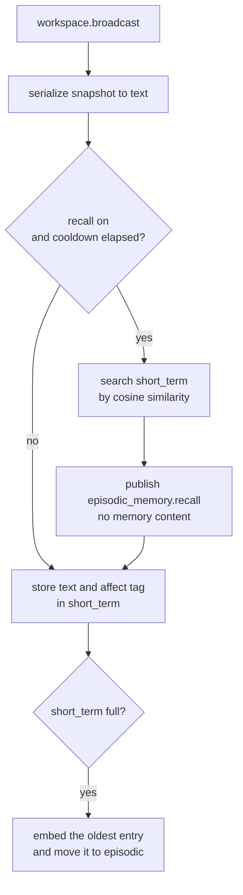

# Episodic memory

The episodic memory module stores what KAINE experiences. It stores a text trace of every broadcast in a short-term buffer, consolidates the buffer into an episodic store, recalls related traces as the entity goes, and replays affect-laden traces during sleep. It draws on hippocampal and medial temporal episodic memory (Tulving 1985) and on the complementary-learning-systems account of slow, interleaved consolidation from a fast store into a slow one (McClelland, McNaughton, and O'Reilly 1995). Semantic and procedural stores are reserved. With the episodic memory module present, the consolidation phases of the [sleep](sleep.md) module have material to work on. Read this page if you are enabling memory, tuning recall, or changing how traces are stored and replayed.

## Status

The episodic memory module is built and tested, and held: it is off in the shipped `config/kaine.toml` (`[modules].episodic_memory = false`) and in the first-configuration `first_configuration` profile that the loader applies when no profile is selected. The [module-addition study](../15-experiments/ignition-study.md) (the ignition study in code) adds it first in its default order of six: the episodic memory, world model, planning, self-model, social cognition, vocal modules. The study overlay gives each line of the study its own collections (`[episodic_memory].collection_prefix`).

- The production backend is Qdrant. It needs a running Qdrant container and an API key.
- The `inmemory` backend is for tests and minimal setups. The `sqlite_vec` backend (alias `sqlite-vec`) is an in-process SQLite vector store for low-resource hosts.
- Embeddings come from the shared `[embedding]` text embedder. By default that is the NumPy implementation of `all-MiniLM-L6-v2` (384 dimensions, on the CPU). The `sentence_transformers` backend remains available.
- `sentence-transformers` is needed only when `[embedding].backend = "sentence_transformers"`, and `qdrant-client` only for the Qdrant backend.

## What it does

On every broadcast, accessed or inhibited, the episodic memory module serializes the snapshot to text, runs a recall against that text, and then stores the text in the short-term buffer. Three commitments shape it.

- Recall runs before store. The cue retrieves earlier related traces, so it cannot return the trace being stored on the same tick. Recall is internal and is not gated on whether the broadcast was inhibited.
- Every trace carries an affect tag: the latest affect module state at store time, as plain numbers (`intensity`, which is the arousal, plus `valence` and `dominance`).
- Replay happens only inside a sleep. The sleep module opens the replay window with `open_replay_window()` immediately before phase 2's replay and closes it with `close_replay_window()` afterwards; `replay()` raises `ReplayWindowError` at any other time.

## Inputs

| Source | Stream / event | What is used |
|---|---|---|
| Workspace | `workspace.broadcast` | The snapshot, serialized to text for the store and the recall cue |
| Affect | `affect.out` / `affect.state` | Arousal, valence and dominance, cached as the affect tag for the next store |
| Sleep | `sleep.out` / `sleep.sleep.completed` | Closes the replay window if it is still open and drops the consolidated entries |

A background task, `_peer_consumer_loop`, reads the affect and sleep modules' events, so the affect tag stays current between broadcasts. `sleep.sleep.started` does not open the replay window: the poll runs every 50 ms, and a sleep whose phase 1 is quicker than that would reach its replay with the window still closed.

## Outputs

| Stream | Event type | Payload fields | Intensity |
|---|---|---|---|
| `episodic_memory.out` | `episodic_memory.recall` | `count`, `collection`, `query_length`, `max_affect_intensity` | `alert_salience` if `max_affect_intensity ≥ 0.5`, otherwise `baseline_salience` |
| `episodic_memory.out` | `episodic_memory.replay` | `memory_id`, `text`, `affect`, `affect_intensity`, `source_timestamp`, `replayed_at` | `baseline_salience` |

`episodic_memory.recall` carries no memory content and no query text. A storage failure publishes a `episodic_memory.recall` with `count = 0`, `error = true` and an `error_detail`. `episodic_memory.replay` carries the trace text, because a replayed trace enters the workspace competition as a candidate like any other module event, and [the world model module](world-model.md) takes it as a cue for a scenario.

## Configuration

All keys are under `[episodic_memory]` and its sub-tables. Shared keys such as `[embedding]` are in the [module configuration reference](../appendix-a-configuration/modules.md).

| Key | Type | Default | Meaning |
|---|---|---|---|
| `backend` | string | `"qdrant"` | `"qdrant"`, `"inmemory"` or `"sqlite_vec"` (`"sqlite-vec"` is also accepted) |
| `collection_prefix` | string | `"episodic_memory_"` | Prefix of the collection names (Qdrant and sqlite-vec) |
| `short_term_capacity` | int | `128` | Size of the short-term buffer; when it is full, the oldest entry moves to episodic |
| `recall_top_k` | int | `5` | Default number of traces a recall returns |
| `baseline_salience` | float | `0.15` | Intensity of routine recall and of replay events |
| `alert_salience` | float | `0.6` | Intensity of a recall whose strongest trace was stored at arousal 0.5 or higher |
| `recall_on_workspace` | bool | `true` | Whether recall runs on each broadcast |
| `recall_cooldown_s` | float | `5.0` | Minimum entity-time seconds between recalls |
| `[episodic_memory.qdrant].host` | string | `"127.0.0.1"` | Qdrant host |
| `[episodic_memory.qdrant].port` | int | `6533` | Qdrant port |
| `[episodic_memory.qdrant].api_key` | string | unset | Qdrant API key; see below |
| `[episodic_memory.replay].selection_top_k` | int | `5` | Traces replayed per sleep |
| `[episodic_memory.replay].affect_weight` | float | `0.7` | Weight of the affect intensity in the replay score |
| `[episodic_memory.replay].recency_weight` | float | `0.3` | Weight of recency in the replay score |
| `[episodic_memory.replay].redact_content` | bool | `true` | Strip `text` from the observer copy of each replay |
| `[episodic_memory.replay].cross_period_candidates` | int | `128` | Newest episodic traces that sleep's cross-period selection reads, without vectors; matches `short_term_capacity` |
| `[episodic_memory.strength].retention_per_day` | float `(0, 1)` | `0.82` | Strength an unreplayed trace keeps over one entity day of storage at the resting rate |
| `[episodic_memory.strength].traces_per_day` | float | `288000` | N_day, the traces one entity day at the resting rate stores (paper value 86400 x 10/3; independent of the cycle rate) |
| `[episodic_memory.strength].prune_floor` | float `(0, 1)` | `0.01` | Strength below which a sleep deletes a trace |
| `storage_budget_bytes` | int | `10737418240` | Budget of the persisted stores in bytes; sleep deletes the weakest traces until they fit. Set it for the installation |

`recall_on_workspace` and `recall_cooldown_s` are not written in the shipped file; the values above are the constructor defaults. `[episodic_memory]` rejects `embedder_model_id` and `device` at boot and points to `[embedding].model_id` and `[embedding].device`. The cycle fills `[episodic_memory.qdrant].api_key`, when it is not set, from `KAINE_QDRANT_API_KEY` or from `[qdrant].api_key` in `config/secrets.toml`, and the Qdrant backend refuses to start without a key.

## How it works

### Collections

| Collection | Backing | Notes |
|---|---|---|
| `short_term` | In-process deque (capacity 128) | When full, the oldest entry moves to `episodic` |
| `episodic` | Qdrant or sqlite-vec | Traces consolidated from short-term |
| `semantic` | Qdrant or sqlite-vec | Reserved for conceptual knowledge |
| `procedural` | Qdrant or sqlite-vec | Reserved for skill traces |

The short-term buffer is working memory. It is not saved by `serialize()`, but preservation captures it with the persisted points (see below).

### Each broadcast



The cooldown runs on entity time, so it stretches and shrinks with `time_scale`. The live recall searches only the short-term buffer, by cosine similarity to the embedded cue. Storing needs no embedding: each short-term entry is embedded once, in memory, the first time a recall needs it, and an entry is embedded for the backend when it moves to `episodic`.

### Embedder

The episodic memory module uses the shared text embedder from `[embedding]`. One instance loads once and serves the episodic memory, social cognition, sleep modules and the evaluation sidecar.

- The NumPy backend (the default) is `NumpyMiniLMEmbedder` in `kaine/text_embedding_numpy.py`. It runs the `all-MiniLM-L6-v2` encoder from the model's `model.safetensors`, `config.json` and `vocab.txt` with a built-in WordPiece tokenizer, mean pooling and L2 normalisation. It needs only NumPy (SciPy, when present, supplies `erf`). Its 384-dimensional vectors match the sentence-transformers backend within 1e-5 on the same token ids.
- The torch backend is `SentenceTransformerTextEmbedder` in `kaine/text_embedding.py`. `kaine/modules/episodic_memory/embeddings.py` re-exports it as `SentenceTransformerEmbedder` for older imports.

Tests use `FakeEmbedder`, which maps text to a deterministic 32-dimensional vector from a blake2b digest.

### Affect tag

`_peer_consumer_loop` caches the latest `affect.state` as:

```python
{"intensity": arousal, "valence": valence, "dominance": dominance}
```

Every store on the broadcast path attaches this cache to the `StoredMemory`.

### Trace strength

Each persisted trace carries a strength in (0, 1], the analog of a synaptic strength (paper §4 and Appendix A.10). A trace is stored at strength 1 and changes only when a sleep downscales it. Its payload holds four keys that the episodic memory module owns and a caller cannot set: `log_base`, `born_sleep`, `entity_time` and `size_bytes`, the size of the trace's record (its float32 embedding plus its serialized text, payload and affect). The strength is `exp(log_base + L)`, where `L` is a log gain the store keeps in a meta record beside the embedding-space stamp, together with the sleep count, the total strength, the size of the stores in bytes and the entity time of the last sleep. A trace is persisted with `log_base = -L` and `born_sleep` equal to the sleep count, so a sleep that scales every trace changes only `L` and the few replayed traces, never the whole store. `entity_time` is the storage time on the entity clock and continues across restarts; the wall-clock `timestamp` stays as it was, because the live memory prober reads it.

The sleep module prunes the stores (paper A.10). A trace whose strength falls below `[episodic_memory.strength].prune_floor` is deleted in the sleep that weakened it. Then, while the stores are larger than `[episodic_memory].storage_budget_bytes`, the weakest trace is deleted, the oldest first among equal strengths, until they fit or only the traces replayed in that sleep remain; those are never pruned in it. Nothing is deleted while the entity is awake, so between two sleeps the stores can exceed the budget by the traces stored since the last one. With a budget that does not bind, a trace that is never replayed reaches the floor after about 23 entity days and the stores settle near 6.7 million traces at the resting rate. Set the budget from the disk the installation can give the episodic memory module; the shipped 10 GiB is a safe default with no basis in the paper.

Recall from a persisted collection returns the requested number of traces with cosine similarity above 0, ranked by strength times similarity. It widens its search until the k-th product is at least the smallest cosine it has fetched, which bounds every trace it has not fetched, since no strength exceeds 1. The widening stops at the 4096 nearest traces; beyond that the order is approximate, and the episodic memory module logs it once for that recall. Each result reports `similarity`, `strength` and `score`, the product. Short-term traces have strength 1 and rank by similarity alone. On sqlite-vec the vector table has `collection` as a partition key, so the index filters by collection itself, and search pages past the extension's limit of 4096 rows with its distance constraint. An older vector table is rebuilt once when the store opens.

At initialize the episodic memory module gives every trace from before trace strengths a strength of 1 and `born_sleep = -1`, and a store whose meta record is missing while its traces carry `log_base` is refused. A preservation capture carries the meta record under `strength`; a bundle without it is backfilled the same way, unless its traces already carry `log_base`, which is refused. A preservation copies the stores as they stand at capture, so a later pruning deletes nothing from a preserved entity. An import marks the meta record as pending before it replaces any collection and clears the mark when it finishes; after an interrupted import, initialize logs an error and every sleep is blocked (no downscaling, no pruning; the sleep summary records `memory_downscale_blocked = "import_pending"` and the count of consecutive blocked sleeps `memory_blocked_sleeps`) until the revive is run again. While the mark is set and the stores exceed twice the budget, the episodic memory module refuses to store new traces, logs each refusal as an error and counts it (`memory_persist_refusals`); this bounds the disk and is not a welfare event. The episodic memory module writes this state to `state/episodic_memory/store_health.json`, which the Dashboard health board shows as the **Memory store** panel, red while the mark is set. The recovery when the bundle is gone is `python -m kaine.lifecycle.episodic_memory_recover --confirm-keep-current-store` (see [Preservation](../11-preservation.md#an-interrupted-memory-import)). Decommission keeps the meta record when a collection drop fails. Decommission deletes the meta record with the stamp.

### Sleep: consolidation, replay, downscaling and pruning

The sleep module calls the episodic memory module in its consolidation phases.

1. Phase 1 calls `consolidate_now()`, which moves every short-term entry to `episodic` and drops nothing. The episodic memory module keeps the moved entries, each with the episodic point id it was stored under, for phase 3.
2. Phase 2 opens the replay window, calls `replay_now()` with perception already suspended for the whole sleep, and closes the window. It then calls `downscale(protect=...)` with the replay events. Every persisted trace outside the replayed set is scaled by `retention_per_day ** (N_new / N_day)`, where `N_new` counts the traces stored since the previous sleep and `N_day = [episodic_memory.strength].traces_per_day` counts the traces of one entity day at the resting rate (288,000, the paper's 86400 x 10/3). The replayed traces keep their strength, which is how the synaptic homeostasis hypothesis reads reactivation in sleep (Tononi and Cirelli 2006; 2014). A wake that stored nothing changes no strength. The meta record is written before the replayed traces, so a crash between the two can only remove strength. The same call then prunes at the floor and for the budget, as above. The size of the stores is recomputed from a scan at initialize and at the start of each sleep, and it changes only after a deletion succeeds, with the meta record written after each one, so a failed or interrupted pruning never leads the next sleep to prune too much. If replay fails, phase 2 skips the downscaling and pruning for that sleep; the wake's traces stay in the next sleep's pool. The returned summary (`n_new`, `factor`, `protected`, `total_before`, `total_after`, `pruned_floor`, `pruned_budget`, `store_bytes`) goes into the phase metadata, and the sleep module copies the two pruning counts and the store size to the top of the sleep summary as `memory_pruned_floor`, `memory_pruned_budget` and `memory_store_bytes`, which the research log keeps.
3. Phase 3 (associative replay, off by default with `[sleep.consolidation].associative_replay = false`) calls `select_cross_period_traces()`.

`replay_now()` builds its candidates from the whole wake just ended: every persisted trace whose `born_sleep` is the current sleep count, which includes the entries phase 1 moved and the ones the wake persisted when the buffer overflowed, plus anything still short-term. The `ReplayEngine` raises `ReplayWindowError` if the window is not open, scores each candidate as `affect_weight × intensity + recency_weight × recency`, where recency runs on `entity_time` from 0 for the oldest candidate to 1 for the newest, keeps the `selection_top_k` best, and publishes each as `episodic_memory.replay` with its point id and collection. It also returns an observer copy of each payload, with `text` removed when `redact_content = true`. The selection follows the replay of selectively strengthened traces during sleep (Wilson and McNaughton 1994; Wei et al. 2016) and sleep's selection among newly encoded memories (Stickgold and Walker 2013).

The downscaling ends the wake, so a sleep never replays an earlier sleep's traces. The episodic memory module drops the entries phase 1 moved when it sees `sleep.sleep.completed`.

`select_cross_period_traces(periods, per_period)` sorts the available traces by timestamp, splits the time span into `periods` equal windows and takes up to `per_period` traces from each. The available traces are the short-term buffer, the entries phase 1 moved, and the newest `cross_period_candidates` traces of the episodic collection, which it reads through the storage backend's `recent_points()` without their vectors, so it works on the in-memory, Qdrant and sqlite-vec backends alike. Each trace counts once, and a storage error propagates so phase 3 records it.

## Key files

| Path | Purpose |
|---|---|
| `kaine/modules/episodic_memory/module.py` | `EpisodicMemory(BaseModule)`: broadcast handling, affect consumer, replay, preservation |
| `kaine/modules/episodic_memory/memory.py` | `EpisodicMemoryCore` (store, recall, consolidate, downscale and prune), `StoredMemory`, `RecallSummary`, `EmotionalRetriggerHook` |
| `kaine/modules/episodic_memory/storage.py` | `MemoryStorage` protocol, `QdrantStorage`, `InMemoryStorage`, `SqliteVecStorage`, `RecalledMemory` |
| `kaine/text_embedding.py` | `Embedder` protocol, `SharedEmbedder`, `make_text_embedder`, `SentenceTransformerTextEmbedder`, `FakeEmbedder` |
| `kaine/text_embedding_numpy.py` | `NumpyMiniLMEmbedder` |
| `kaine/modules/episodic_memory/embeddings.py` | Re-export of `kaine.text_embedding` names for older imports |
| `kaine/modules/episodic_memory/replay.py` | `ReplayEngine`, `ReplayEntry`, `ReplayEvent`, `select_traces`, `build_replay_events` |
| `kaine/boot/factories/episodic_memory.py` | `make_episodic_memory()`: backend and replay sub-table |

## Enabling

1. Start the Qdrant container: `docker compose -f compose/qdrant.yml up -d`.
2. The first time, run `bash scripts/qdrant-bootstrap.sh`. It generates the API key, writes it to `compose/.env` and `config/secrets.toml`, and checks `/readyz`.
3. In the operator file `config/kaine.operator.toml`, set `[modules].episodic_memory = true`. The same flag in the shipped `config/kaine.toml` would be overridden by the `first_configuration` profile, which the loader applies when no profile is selected.
4. To run without Qdrant, set `backend = "inmemory"` or `backend = "sqlite_vec"` and leave out the API key.

In tests, replay can be driven by hand:

```python
episodic_memory.replay_engine.open_window()
events = await episodic_memory.replay_now()
episodic_memory.replay_engine.close_window()
```

## What Episodic memory keeps

The stored `text` is a content view of the snapshot. It starts with `active` or `inhibited`, then lists `{source}:{type}={payload}` for each coalition member. Every payload passes through `kaine.privacy_filter.strip_vectors` first, which removes named vector fields and any numeric list of 16 or more items. The payloads of `audition.transcription` and `embodiment.visual.raw` are replaced by `<raw-perceptual omitted>`. A `episodic_memory.replay` member is recorded as `<replay of {memory_id}>` without the replayed text, so a trace stored during sleep never contains the trace it replayed. The tick index is kept in the stored payload, with the inhibited flag and the coalition size, and is not repeated in the text; bus entry ids are left out because they lose meaning once the stream is trimmed. Affect tags are plain numbers.

`EpisodicMemory.serialize()` emits `short_term_size`, `collection_prefix` and `embedding_space`, and no memory content. `export_preservation_state()` captures the full store, short-term buffer included, and fails loudly if the backend cannot be read; see [Preservation and the safety net](../11-preservation.md).

## Tests

| File | Coverage |
|---|---|
| `tests/test_episodic_memory_memory.py` | `EpisodicMemoryCore` store, recall and consolidation with `FakeEmbedder` and `InMemoryStorage` |
| `tests/test_episodic_memory_recall_cosine.py` | Cosine recall over the short-term buffer |
| `tests/test_episodic_memory_storage.py` | `InMemoryStorage` search; `QdrantStorage` with a mocked client |
| `tests/test_episodic_memory_embeddings.py` | `FakeEmbedder` determinism; lazy loading of `SentenceTransformerEmbedder` |
| `tests/test_text_embedding_numpy.py` | NumPy embedder: safetensors reader, WordPiece tokenizer, parity with sentence-transformers |
| `tests/test_shared_embedder.py` | One `SharedEmbedder` load across modules and the supervisor rebuilds |
| `tests/test_episodic_memory_replay.py` | Replay scoring, the window guard, `ReplayWindowError` |
| `tests/test_episodic_memory_replay_redact.py` | `redact_content` in observer payloads |
| `tests/test_episodic_memory_module.py` | Module tick, affect caching, recall cooldown, recall before store |
| `tests/test_episodic_memory_trace_strength.py` | Trace strength on all three backends: persist keys, downscaling factor and protection, recall by strength times similarity against brute force, sqlite-vec paging past 4096 rows, migration, preservation, numerics over many sleeps |
| `tests/systems/test_episodic_memory_subsystem.py` | End-to-end subsystem test |

The offline suite's memory-coherence battery (`kaine/evaluation/benchmarks/instrument_runners/memory_coherence_runner.py`) exercises the episodic memory module offline.

## Spec and related

- Primary spec: [`openspec/specs/episodic-memory/spec.md`](../../openspec/specs/episodic-memory/spec.md)
- Replay spec: [`openspec/specs/mnemos-replay/spec.md`](../../openspec/specs/mnemos-replay/spec.md)
- Related modules: [Sleep](./sleep.md) runs the consolidation phases; [Affect](./affect.md) supplies the affect tag; [World model](./world-model.md) turns replay cues into scenarios.
