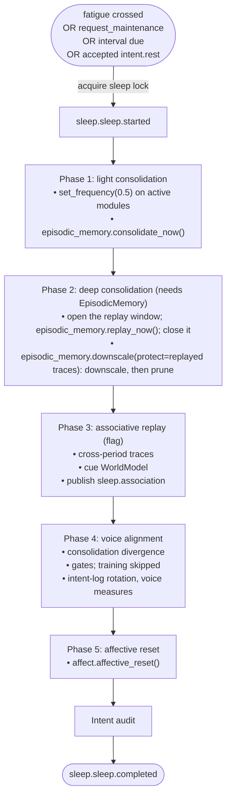

# Sleep

The sleep module is the sleep analog: a fatigue-triggered offline period during which the four predictive processors stop adapting their forward models, and at whose end affect and drives return to baseline. This page is the module reference. It covers what starts a sleep, what a sleep does in the first configuration and with the held modules, the events the sleep module publishes, and its configuration. The full pipeline is described in [Sleep and maintenance](../10-sleep/README.md), and the gated training phase in [Voice alignment](../10-sleep/voice-alignment.md).

## Status

The sleep module ships disabled in the default config (`[modules].sleep = false` in `config/kaine.toml`). The `first_configuration` profile enables it, because fatigue-triggered rest and the affective reset are part of the first configuration.

Three parts of the pipeline stay off unless an operator turns them on. Associative replay needs `[sleep.consolidation].associative_replay = true` and the world model module. Voice alignment needs `[sleep.voice_alignment].enabled = true` and the environment variable `KAINE_VOICE_ALIGNMENT_OPERATOR_APPROVED=1`, and even then it trains nothing, because no validated preference source exists yet (see [Voice alignment](../10-sleep/voice-alignment.md)). Memory consolidation and replay need the episodic memory module.

## What a sleep is

A sleep runs between a `sleep.sleep.started` and a `sleep.sleep.completed` event. The cognitive cycle keeps running throughout. A sleep lock stops a second sleep from starting, and nothing else waits on it. When the sleep starts, `enter_sleep` switches the perceptual locus to `off` and pauses the shared stimulus playlist; when it ends, including after a failure or cancellation, it restores the remembered pre-sleep locus (falling back to `physical`) and resumes the playlist. Sleep time does not count as awake time.

The predictive processors read `sleep.out` and suspend forward-model adaptation for the whole window: the vision, audition (both its acoustic and its tone forward models), interoception and sequence modules. Each keeps predicting and reporting, but none updates its weights until `sleep.sleep.completed` arrives. The interoception module's fatigue decays three times faster while the window is open.

Every sleep ends with phase 5, the affective reset. It calls the affect module's `affective_reset()`, which returns valence, arousal and dominance to baseline, clears the drives and the learning-progress and alert-rate trackers, and publishes `affect.state` with `reset: true` (see [the affect module](affect.md#sleep-reset)). When `sleep.sleep.completed` arrives, the interoception module resets its fatigue accumulator and its regulation state. Because every sleep ends this way, arousal cannot drift across a whole run.

### In the first configuration

With the episodic memory module, the world model module and voice alignment off, the consolidation phases do no work:

- Phase 1 calls the oscillator hook, a no-op unless the oscillatory layer is active, and skips consolidation.
- Phase 2 returns at once. The perceptual feed is paused for the whole sleep in any case (see [Sleep](../10-sleep/README.md)).
- Phase 3 is skipped by its flag.
- Phase 4 computes the consolidation-divergence metric and skips training. The sleep module then rotates the language organ's intent log into the per-sleep corpus and computes the content-free voice measures.
- Phase 5 resets the affect module.

After the phases the sleep module runs the sleep-time intent audit. A base-form sleep is therefore short, and what it does is suspend adaptation, reset affect and drives, and reset the interoception module's fatigue. The consolidation phases begin to work once the episodic memory and world model modules join.

## Triggers

| Trigger | Source | Condition |
|---|---|---|
| Fatigue | `interoception.out`, `interoception.fatigue` | `crossed == true` |
| Maintenance request | `interoception.out`, `interoception.regulation` | `action == "request_maintenance"` |
| Interval backstop | `RestScheduler.is_due()` | `interval_seconds` of entity time since the last completed sleep, or since boot (one entity hour by default) |
| Requested rest | `action_selection.out`, `intent.rest` | At least `requested_rest_min_interval_s` of entity time since the last sleep ended, and no sleep running |

The fatigue and maintenance triggers share one consumer loop, which runs only when `[sleep.consolidation].fatigue_triggered = true`. A maintenance poll checks `is_due()` regardless. `is_due()` is true once the effective deadline has passed, or once the original deadline plus `max_deferral_seconds` has passed. `try_defer()` pushes the effective deadline back by `per_defer_seconds`, up to that cap; nothing in the running system calls it outside tests.

Rest requests come from the planning module through the action selection module's `PlanningProposalSource` (`origin = "planning"`), so they arise only when the planning module is enabled. The sleep module answers each with a `sleep.rest_request` event at intensity 0.0, so the answer never competes for the workspace.

## Pipeline

Each phase catches its own errors, and the later phases still run after one fails. The affective reset runs in a `finally` after phases 1 to 4, shielded from a second cancel, so even a sleep that raises or is cancelled ends with it, and an aborted `sleep.sleep.completed` is published on any exception, including a cancel. Phase 3 re-injects the world model module's scenarios as `sleep.association` events, which compete in the workspace like any other event. The order follows the paper (§3.5): replay, then synaptic downscaling, then associative replay, then the voice, and sleep ends with the affective reset. Phase 2 opens the episodic memory module's replay window itself, immediately before it replays, and closes it afterwards, so replay never depends on the episodic memory module having seen `sleep.sleep.started` on the bus. When the world model module is present, the sleep module also opens its scenario window before phase 2, whose replay cues the world model module through `episodic_memory.replay`, and closes it in a `finally` after phase 3, which cues the world model module directly. On shutdown, the sleep module stops its loops, cancels a sleep still in flight and waits for it, so the sleep ends with the affective reset and an aborted `sleep.sleep.completed`, then waits for the reset and publish tasks it holds; each wait is bounded at 5 s. The cycle's shutdown and Supervisor's halt shut the sleep module down before the other modules, so the sleep ends while the episodic memory, affect and world model modules are still up. The phase functions are in `kaine/modules/sleep/phases.py`; phase 4 is driven from `kaine/modules/sleep/module.py`.

## Outputs

| Stream | Event type | Description | Intensity |
|---|---|---|---|
| `sleep.out` | `sleep.sleep.started` | Start of the pipeline; carries `started_at`, and `trigger: "requested"` for a requested rest | `baseline_salience` |
| `sleep.out` | `sleep.sleep.completed` | Summary: `phases`, `voice_alignment`, `total_elapsed_ms`, `fatigue_triggered`, `pairs_processed`, `dpo_loss`, the capability scores, `corpus`, `voice_measures` and `ignition_audit`. If the pipeline itself aborts, the payload is `{"aborted": true, "reason": <exception class name>}` | `baseline_salience` when every phase succeeded, else `alert_salience` |
| `sleep.out` | `sleep.association` | A phase-3 scenario re-injected into the workspace | `baseline_salience` |
| `sleep.out` | `sleep.rest_request` | Answer to a rest request: `accepted`, and `reason` of `accepted`, `busy`, `too_soon` or `aborted` | `0.0` |
| `sleep.out` | `sleep.consolidation_divergence` | Content-free divergence metric, every sleep | `baseline_salience` |
| `sleep.out` | `sleep.ignition_audit` | Content-free intent audit, every sleep | `baseline_salience` |

The sleep module reports at these fixed levels; its events are not graded by surprise. The interoception module resets fatigue and regulation in response to `sleep.sleep.completed`, and the four processors resume adaptation on it, so an aborted sleep still ends the window.

## Configuration

The full reference is in [Perception feed and sleep](../appendix-a-configuration/perception-and-sleep.md). Intervals run in entity time.

`[sleep]`:

| Key | Type | Default | Meaning |
|---|---|---|---|
| `interval_seconds` | float `> 0` | `3600.0` | Interval backstop: longest time between completed sleeps |
| `max_deferral_seconds` | float `>= 0` | `600.0` | Most the backstop can be deferred past its original deadline |
| `per_defer_seconds` | float `> 0` | `60.0` | Deferral added per `try_defer()` |
| `requested_rest_min_interval_s` | float `> 0` | `1800.0` | Minimum time from the end of a sleep before a rest request is accepted |
| `baseline_salience` | float `[0, 1]` | `0.5` | Intensity of routine sleep events |
| `alert_salience` | float `[0, 1]` | `0.8` | Intensity of a completed event after a failed phase |

The retired key `planning_step_burst` is accepted and ignored with a warning, so older local configs still boot.

`[sleep.consolidation]`:

| Key | Type | Default | Meaning |
|---|---|---|---|
| `fatigue_triggered` | bool | `true` | Run the `interoception.out` consumer; `false` disables both the fatigue and the maintenance-request triggers |
| `replay_window_s` | float | `5.0` | Recorded in phase-2 metadata; replay runs to completion regardless |
| `associative_replay` | bool | `false` | Enable phase 3 |

`downscale_factor` is refused at boot: phase 2 downscales trace strengths by `[episodic_memory.strength].retention_per_day` instead (paper A.10).

`[sleep.voice_alignment]` is documented in full on the [Voice alignment](../10-sleep/voice-alignment.md#configuration) page.

## Sleep-time intent audit

Every sleep, the sleep module publishes `sleep.ignition_audit` for the window since the previous sleep (or since boot). It classifies each realized intent, an `external_speech`, `internal_speech`, `vocal.synthesized` or `effectors.action` event or a requested `sleep.sleep.started` (never a `realization_failed`), by the coalition that produced it:

| Class | Rule |
|---|---|
| `planning_initiated` | The intent's `origin` is `"planning"`; checked first |
| `input_triggered` | The coalition holds `audition.transcription` or `embodiment.chat` |
| `drive_triggered` | The coalition holds `affect.drive` |
| `self_initiated` | None of the above |

`intent.*` events on `planning.out` are counted separately as unrealizable, since no effector reads that stream, and `action_selection.proposal_outcome` events add realized, declined and forwarded proposal counts. The payload holds counts, entry ids, event types, intensities and `sleep_index`, and no text, transcripts or latent vectors. It is also merged into the `sleep.sleep.completed` summary.

## Consolidation divergence

At the start of phase 4, on every sleep, the pair builder scans the intent-expression log and counts the records in which the organ's generated text differs from the faithful rendering of the coalition it was conditioned on. The sleep module publishes the result as `sleep.consolidation_divergence`:

| Field | Meaning |
|---|---|
| `records_scanned` | Records read |
| `usable_pairs` | Records with both fields present and different |
| `divergence_rate` | `usable_pairs / records_scanned` |
| `divergence_magnitude` | Mean cosine distance over the kept pairs with the shared semantic embedder (`kaine.text_embedding`); null when no embedder is available |
| `sleep_index` | Number of this sleep since boot |

The metric is computed whether or not training runs and is persisted to `state/sleep/consolidation_divergence.json`. A scan that fails or finds no records keeps the earlier record in place (`record_kept: true`). The welfare-gated decommission check described in [Preservation and the safety net](../11-preservation.md) reads it against `consolidation_divergence_rate_threshold` and `consolidation_divergence_magnitude_threshold`.

## Key files

| File | Role |
|---|---|
| `kaine/modules/sleep/module.py` | `Sleep`: triggers, pipeline, perception suspension, divergence, phase 4 |
| `kaine/modules/sleep/phases.py` | Phases 1 to 4 |
| `kaine/modules/sleep/scheduler.py` | `RestScheduler`: interval and deferral |
| `kaine/modules/sleep/ignition_audit.py` | Sleep-time intent audit |
| `kaine/modules/sleep/corpus.py` | Intent-log rotation and the corpus ceiling check |
| `kaine/modules/sleep/voice_measures.py` | Content-free voice measures |
| `kaine/modules/sleep/voice_alignment.py` | `VoiceAlignmentConfig`, `DPOPairBuilder`, `FakeTrainer`, the divergence record |
| `kaine/modules/sleep/subprocess_trainer.py` | `SubprocessVoiceTrainer`, used by the `in_process` and `subprocess` backends |
| `kaine/modules/sleep/job_queue_trainer.py` | `JobQueueVoiceTrainer`, the cycle side of the `job_queue` backend |
| `kaine/modules/sleep/trainer_service.py` | The `kaine-trainer` service |
| `kaine/modules/sleep/capability_eval.py` | Capability and abliteration probe evaluators |
| `kaine/modules/sleep/adapter_store.py` | Atomic promotion and retention |
| `kaine/modules/sleep/hot_swap.py` | Hot-swap dispatch |
| `kaine/modules/sleep/organ_adapter.py` | Per-entity adapter activation on the organ server |
| `kaine/modules/sleep/organ_window.py` | Single-GPU unload, train and reload bracket |
| `kaine/modules/sleep/voice_audit.py` | Abliteration-veto audit trail |
| `kaine/boot/factories/sleep.py` | Config parsing, backend and hot-swap validation, trainer selection |

## Enabling and use

1. Set `[modules].sleep = true`, or run the `first_configuration` profile.
2. Enable the interoception module for the fatigue and maintenance triggers and the affect module for the affective reset.
3. For memory consolidation and replay, enable the episodic memory module. For associative replay, also set `[sleep.consolidation].associative_replay = true` and enable the world model module.

## Tests

| File | Coverage |
|---|---|
| `tests/test_sleep_phases.py` | Phase functions and `PhaseResult` shape |
| `tests/test_sleep_module.py` | Full pipeline and the completed-event shape |
| `tests/test_sleep_trigger.py` | Fatigue trigger |
| `tests/test_sleep_scheduler.py` | Interval and deferral |
| `tests/test_sleep_rest_requests.py` | `intent.rest` handling |
| `tests/test_sleep_sleep_pause.py` | The perceptual locus module and playlist pause and restore |
| `tests/test_sleep_associative_replay.py` | Phase 3 |
| `tests/test_sleep_oscillator_hook.py` | Phase-1 oscillator hook |
| `tests/test_sleep_nar_removal.py` | Replay reaching the workspace through the normal cycle |
| `tests/test_sleep_replay_handoff.py` | Phase 2 replaying the traces phase 1 consolidated, with the episodic memory module |
| `tests/test_interoception_sleep_flag.py` | The interoception module's `crossed` flag |
| `tests/test_sleep_suspension_cursor.py` | the vision, audition and sequence modules suspending adaptation during sleep |
| `tests/test_sleep_voice_alignment.py`, `tests/test_sleep_voice_alignment_integration.py` | Pair builder, gates and vetoes |
| `tests/test_sleep_organ_window_bracket.py` | Organ window |
| `tests/test_sleep_world_model_window.py` | the world model module's scenario window around phases 2 and 3, through a real sleep on the bus |
| `tests/test_sleep_shutdown.py` | Shutdown during a sleep and during a held reset; the bounded wait |
| `tests/test_module_shutdown_order.py` | The cycle and Supervisor shut the sleep module down first, so the reset runs while the affect module is up |

## See also

- [Sleep and maintenance](../10-sleep/README.md)
- [Voice alignment](../10-sleep/voice-alignment.md)
- [Interoception](interoception.md), [Affect](affect.md), [Episodic memory](episodic-memory.md), [World model](world-model.md), [Language](language.md)
- [Preservation and the safety net](../11-preservation.md)
- [Perception feed and sleep](../appendix-a-configuration/perception-and-sleep.md)
