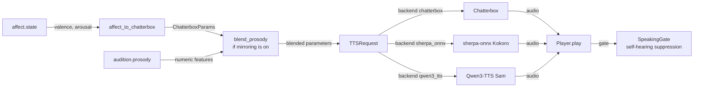

# Vocal

The vocal module is KAINE's voice. It turns the language organ's external speech into sound with local speech synthesis, and it varies the prosody of that sound with the entity's affect. It draws on speech production along the dorsal stream (Hickok and Poeppel 2007), and the question it adds to the module-addition study is whether listeners can detect that affect-driven variation. This page covers the synthesis backends, how the voice is chosen, the mapping from affect to prosody, optional prosodic mirroring of a conversation partner, and self-hearing suppression. Read it if you are enabling spoken output or changing how text becomes sound.

## Status

The vocal module is built and tested, and held: it is off in the shipped `config/kaine.toml` (`[modules].vocal = false`) and in the `first_configuration` profile. The [module-addition study](../15-experiments/ignition-study.md) (the ignition study in code) adds it sixth and last in its default order of six: the episodic memory, world model, planning, self-model, social cognition and vocal modules.

`[vocal].backend` selects the synthesizer: `"chatterbox"` (the default), `"sherpa_onnx"` or `"qwen3_tts"`. The file sink (`sink_enabled`) is off by default, self-hearing suppression is on, and prosodic mirroring is off (`[vocal.mirroring].enabled = false`).

During the developmental phase the vocal module is held dormant, since the developmental stimulus has no air to speak into, and the gate runner activates it at maturation. Inner speech is unaffected.

Prosodic mirroring needs Audition with `prosody_enabled = true`, which needs `librosa` (`pip install -e .[audio]`).

## Backends

| Backend | Engine | Default | Notes |
|---|---|---|---|
| `chatterbox` | Chatterbox TTS service | yes | HTTP service with expressive controls: `temperature`, `exaggeration`, `cfg_weight` and `speed_factor` |
| `sherpa_onnx` | sherpa-onnx with Kokoro | no | In-process and torch-free; Kokoro English int8, 103 MB |
| `qwen3_tts` | Qwen3-TTS with Sam voice | no | In-process via the `qwen-tts` package; GPU required. Supports affect-driven instruct prosody and language control. The shipped default model is `kaineone/Qwen3-TTS-Sam-0.6B` (2.4 GB), a fine-tune of Qwen3-TTS-12Hz-0.6B-Base trained on the [Sam non-binary voice dataset](https://github.com/Sam-Accenture-Non-Binary-Voice/non-binary-voice-files) (Accenture Labs and CereProc, Apache 2.0). Speaker: `sam`. |

The sherpa-onnx backend has these limits:

- Kokoro applies only `speed_factor` from the affect mapping and from mirroring; `temperature`, `exaggeration` and `cfg_weight` have no effect, and its speech is plain.
- The voice is a preset speaker, so an entity moved from one backend to the other does not keep its voice.
- `vocal.synthesized` lists the parameters actually applied in `prosody_applied`: all four under Chatterbox, `["speed_factor"]` under Kokoro. Its `voice` field reads `"kokoro-en speaker N"` under sherpa-onnx.

The Qwen3-TTS backend:

- Applies `instruct` (a natural-language description of the desired prosody, generated from affect state) and `language`. The affect module's valence, arousal and dominance are mapped to instruct strings like "Speak with warm enthusiasm" or "Speak quietly and sadly" by `affect_to_instruct()` in `kaine/modules/vocal/mapping.py`.
- The shipped model is `kaineone/Qwen3-TTS-Sam-0.6B` with speaker `sam`, a gender-neutral English voice. The voice was trained on the Sam non-binary voice dataset created by Accenture Labs and CereProc (Apache 2.0), using the Qwen3-TTS supervised fine-tuning pipeline at learning rate 1e-7, 2 epochs. See the [model card on HuggingFace](https://huggingface.co/kaineone/Qwen3-TTS-Sam-0.6B) for training details.
- `vocal.synthesized` carries `"backend": "qwen3_tts"` and `"prosody_applied"` includes `"instruct"` and `"language"`.
- Requires the `speech-qwen3` extra: `pip install "kaine[speech-qwen3]"`. Needs a CUDA GPU with enough VRAM for the 0.6B model (about 2 GB in bfloat16).

### Choosing a voice

No voice files are distributed with the project, and the shipped config leaves all voice keys unset. When nothing is configured, the vocal module picks a voice the engine itself provides, so it can speak without any operator-local files. The selection rule lives in `kaine/modules/vocal/voices.py` and is deterministic: the same speaker list and settings produce the same voice on every start.

An explicit voice always wins, in this order:

1. `predefined_voice_id` (Chatterbox), `sherpa_speaker_id` (Kokoro) or `qwen3_speaker` (Qwen3-TTS). A configured `predefined_voice_id` is sent as it is, without asking the server, so an operator's own uploaded voice keeps working.
2. `default_voice`, which must name a voice in the engine's list: a Chatterbox filename or display name, or a Kokoro speaker name.
3. The automatic pick: the first voice in sorted order of names, keeping only the voices whose gender matches `voice_gender` where the engine reports gender. For Qwen3-TTS, the default speaker is `sam`.

| Engine | Where the list comes from | Gender |
|---|---|---|
| Chatterbox | `GET /get_predefined_voices` on the server, read once at startup. The upstream server ships 28 voices in its `voices/` directory, listed as `display_name` and `filename`. | Not reported. A `"female"` or `"male"` preference is logged as not applicable and the pick is made from all voices. With the upstream voices the pick is `Abigail.wav`. |
| Kokoro (sherpa-onnx) | The speaker table of the pinned `kokoro-en` model (v0_19, 11 speakers) in `kaine/speech_manifest.py`, from the sherpa-onnx model documentation. | Encoded in the name prefix: the first letter is the accent (`a` American, `b` British), the second the gender (`f` female, `m` male). `"any"` and `"female"` give speaker 0 (`af`), `"male"` gives speaker 5 (`am_adam`). |
| Qwen3-TTS | `model.get_supported_speakers()` on the loaded model, or the configured `qwen3_speaker`. The shipped model has one speaker: `sam`. | Not applicable. The Sam voice is gender-neutral by design. |

The module logs the chosen voice once at startup, for example `vocal module voice: Abigail.wav (first of 28 shipped voices in sorted order)`. The `voice` field of `vocal.synthesized` carries the Chatterbox filename, or `kokoro-en speaker N` under sherpa-onnx.

### Fetching the model

**sherpa-onnx (Kokoro):** Download models ahead of time with `python -m kaine.setup.speech_models [--tts ID] [--yes]`. The command shows each model's name, size and licence and asks for consent. Archives are pinned by URL and SHA-256, verified, and extracted into `state/models/sherpa-onnx/`. The command is idempotent, and nothing downloads at runtime. Kokoro English int8 is 103 MB. Its licences are Apache-2.0 for the model and GPL-3.0-or-later for espeak-ng-data and the espeak-ng engine built into sherpa-onnx. KAINE does not redistribute espeak-ng: the operator installs it with sherpa-onnx and the model after the consent prompt shows both licences.

**Qwen3-TTS (Sam voice):** When the vocal backend is `qwen3_tts`, the first-run wizard (`python -m kaine.setup`) includes `kaineone/Qwen3-TTS-Sam-0.6B` (2.4 GB, Apache 2.0) in its provisioning plan and downloads it from HuggingFace with operator consent. The download uses `huggingface_hub` and lands in the HuggingFace cache (`HF_HOME`). If the operator sets a different `qwen3_model_id`, the wizard downloads that repo instead. The model can also be fetched manually:

```bash
pip install "kaine[speech-qwen3]"
hf download kaineone/Qwen3-TTS-Sam-0.6B
```

The Sam model is a fine-tune of Qwen3-TTS-12Hz-0.6B-Base (Qwen team, Apache 2.0) trained on the Sam non-binary voice dataset (Accenture Labs and CereProc, Apache 2.0). The [model card](https://huggingface.co/kaineone/Qwen3-TTS-Sam-0.6B) has the training parameters and attribution.

### Failure behaviour

- A missing `sherpa-onnx` package stops the boot at the extras check. Install it with `pip install "kaine[speech-edge]"`.
- Missing model files disable the vocal module only, and the health surface shows the reason.
- The dashboard health surface probes Chatterbox only when `backend = "chatterbox"`. For sherpa-onnx it loads the model and runs one real inference once per process, then reports the remembered result with its age, retrying a failure after 60 s.
- When no voice can be chosen (the Chatterbox server is unreachable at startup or lists no voices, `default_voice` is not in the list, or no voice matches `voice_gender`), the vocal module logs one line beginning `vocal module silent:` that names the key to set, records the failure for the health surface, and stays silent. With Chatterbox the module keeps running and plays nothing; restart it once the server answers. With sherpa-onnx the backend fails to build and the vocal module is disabled, as with missing model files. The cycle is never interrupted.
- While speech synthesis is unavailable, the vocal module publishes a failure event at most once every 60 s.

## What it does

When [Language](language.md) realizes a `speak` intent, its text reaches the vocal module for synthesis. The vocal module:

- reads `language.external` for the text to synthesize;
- keeps the latest `affect.state` from the [affect module](affect.md);
- maps the affect to prosodic parameters (all four under Chatterbox, `speed_factor` only under Kokoro);
- optionally blends in a bounded residual of the partner's prosody from `audition.prosody`, which fades after the partner stops speaking;
- plays the audio on the operating system's audio device;
- opens a `SpeakingGate` for the length of the clip plus a hangover, so that an open microphone does not pick up the entity's own voice;
- optionally writes each clip to a bounded file sink;
- publishes `vocal.synthesized` with synthesis metadata and no audio.

In a study viewing the perceptual feed comes from files on the virtual locus, which keeps the real microphone off, so the entity does not hear its own voice.

## Inputs

| Stream | Event type | Description |
|---|---|---|
| `language.external` | `external_speech` | Text to synthesize; each event starts one synthesis |
| `affect.out` | `affect.state` | Latest valence, arousal and dominance for the prosody mapping |
| `audition.out` | `audition.prosody` | Numeric prosody features cached for mirroring (only when mirroring is on) |

## Outputs

| Stream | Event type | Description |
|---|---|---|
| `vocal.out` | `vocal.synthesized` | `text_length`, `bytes_produced`, `voice`, `backend`, `prosody_applied`, `output_format`, `temperature`, `exaggeration`, `cfg_weight`, `speed_factor`, `latency_ms`, `success`, `origin` (when the utterance carries one, for example `planning`), and `error` on failure |

Audio goes to the audio device and, optionally, to the file sink; it never goes on the bus.

## Configuration

Full reference: [`[vocal]` in the modules configuration](../appendix-a-configuration/modules.md).

| Key | Type | Default | Meaning |
|---|---|---|---|
| `backend` | string | `"chatterbox"` | `"chatterbox"`, `"sherpa_onnx"` or `"qwen3_tts"` |
| `sherpa_model_id` | string | `"kokoro-en"` | sherpa-onnx model id |
| `sherpa_model_dir` | string | `<models dir>/sherpa-onnx/<id>` | Directory of the downloaded model files |
| `sherpa_speaker_id` | int | unset | Kokoro preset speaker (0 to 10). Unset, the vocal module picks one (see [Choosing a voice](#choosing-a-voice)) |
| `sherpa_num_threads` | int | `2` | ONNX Runtime threads |
| `qwen3_model_id` | string | `"kaineone/Qwen3-TTS-Sam-0.6B"` | HuggingFace repo for the Qwen3-TTS model |
| `qwen3_tokenizer_id` | string | `"Qwen/Qwen3-TTS-Tokenizer-12Hz"` | HuggingFace repo for the Qwen3-TTS tokenizer |
| `qwen3_device` | string | `"cuda:1"` | GPU device for the Qwen3-TTS model |
| `qwen3_dtype` | string | `"bfloat16"` | Precision: `"bfloat16"`, `"float16"` or `"float32"` |
| `qwen3_speaker` | string | `"sam"` | Speaker name from the model's speaker list |
| `chatterbox_url` | string | `"http://127.0.0.1:8883"` | Chatterbox service URL |
| `voice_mode` | string | `"predefined"` | `"predefined"` uses a voice file the operator has given Chatterbox |
| `predefined_voice_id` | string | unset | A voice filename the Chatterbox server serves, sent without checking. Unset, the vocal module picks a voice the server ships. List the voices with `curl -s http://127.0.0.1:8883/get_predefined_voices`. |
| `default_voice` | string | unset | A voice the engine ships, named explicitly: a Chatterbox filename or display name, or a Kokoro speaker name such as `"af_sarah"`. Used when the backend-specific key above is unset. |
| `voice_gender` | string | `"any"` | `"any"`, `"female"` or `"male"`. Filters the automatic pick where the engine reports gender (Kokoro); Chatterbox reports none. Any other value stops the boot with a configuration error. |
| `output_format` | string | `"wav"` | Audio format |
| `sink_path` | string | `"state/vocal"` | Directory of the optional clip sink |
| `sink_enabled` | bool | `false` | Write clips to disk, bounded by `retain_count` |
| `retain_count` | int | `0` | Newest clips kept; `0` deletes each clip right after it is written |
| `playback_enabled` | bool | `true` | Play audio on the audio device |
| `output_device` | string | `""` | Audio device (empty means the system default) |
| `suppress_self_hearing` | bool | `true` | Open the `SpeakingGate` during playback |
| `mic_mute_hangover_ms` | int | `600` | Milliseconds the gate stays open after a clip ends |
| `baseline_temperature` | float | `0.7` | Chatterbox temperature at neutral affect |
| `baseline_exaggeration` | float | `0.5` | Exaggeration at neutral affect |
| `baseline_cfg_weight` | float | `0.5` | CFG weight at neutral affect |
| `baseline_salience` | float | `0.3` | Intensity of a successful `vocal.synthesized` |
| `alert_salience` | float | `0.7` | Intensity of a failed synthesis (`success = false`) |
| `request_timeout_s` | float | `120.0` | HTTP timeout per synthesis request |
| `language_external_stream` | string | `"language.external"` | Stream read for text |
| `affect_state_stream` | string | `"affect.out"` | Stream read for affect |

`[vocal.mirroring]`:

| Key | Type | Default | Meaning |
|---|---|---|---|
| `enabled` | bool | `false` | Turn on prosodic mirroring from `audition.prosody` |
| `mirror_strength` | float | `0.3` | Blending coefficient, clamped to `mirror_ceiling` at boot |
| `mirror_ceiling` | float | `0.5` | Upper bound on `mirror_strength` |
| `decay_s` | float | `10.0` | Seconds after the last prosody event over which the residual fades to zero |

## How it works

### From affect to Chatterbox parameters

`affect_to_chatterbox()` in `kaine/modules/vocal/mapping.py` is a pure function from `DimensionalState` to `ChatterboxParams`.

| Input | Parameter | Mapping |
|---|---|---|
| arousal, rising | `temperature` rises | Linear within [0.40, 0.95] |
| arousal, rising | `exaggeration` rises | Linear within [0.30, 0.95] |
| absolute valence, rising | `cfg_weight` rises | Linear within [0.30, 0.95] |
| valence, rising | `speed_factor` rises | Linear within [0.85, 1.15], 1.0 at valence 0 |

When the state equals the default `DimensionalState()`, the function returns the configured baseline values. Under sherpa-onnx only `speed_factor` is applied.

### Prosodic mirroring

When mirroring is on, the vocal module reads `audition.prosody` and caches the latest six numbers: `f0_mean_hz`, `f0_std_hz`, `f0_voiced_frac`, `rms_mean`, `rms_std` and `tempo_bpm`. At synthesis time `blend_prosody()` adds a bounded residual to the affect-driven parameters:

| Prosody feature | Parameter nudged | Reference range |
|---|---|---|
| `tempo_bpm` | `speed_factor` | 80 to 180 BPM |
| `rms_mean` | `exaggeration` | 0.01 to 0.20 |
| `f0_std_hz` | `temperature` | 0 to 60 Hz |

Each feature is normalized to [−1, 1] against its reference range. The nudge is `strength × normalized residual × half the band width`, clamped to the parameter's band. The speaker embedding or preset voice is never changed; only the expressive dynamics move. Under sherpa-onnx only the `tempo_bpm` nudge to `speed_factor` has an effect.

The effective strength falls linearly to zero over `decay_s` seconds after the last `audition.prosody` event, computed by `decayed_strength()`. `blend_prosody()` is a pure function.



### Self-hearing suppression

When `suppress_self_hearing = true` and a `SpeakingGate` is wired at boot, the vocal module calls `gate.mark_speaking(duration_s + hangover_s)` before it hands the audio to the player. The [audition module](audition.md)'s live-capture loop polls the gate and drops frames while it is open. An operator with acoustically isolated input, such as a headset microphone, may set `suppress_self_hearing = false`.

### File sink

With `sink_enabled = true`, each clip is written to `<sink_path>/<timestamp>-<uuid8>.<format>`. After each write `_prune_sink()` keeps the `retain_count` newest clips by modification time and deletes the rest, so `retain_count = 0` makes every clip transient.

## Key files

| File | Role |
|---|---|
| `kaine/modules/vocal/module.py` | `Vocal`: consumer loops, synthesis, playback, publication |
| `kaine/modules/vocal/qwen3_tts.py` | The Qwen3-TTS backend |
| `kaine/modules/vocal/sherpa_tts.py` | The sherpa-onnx Kokoro backend |
| `kaine/modules/vocal/mapping.py` | `affect_to_chatterbox()` and `ChatterboxParams` |
| `kaine/modules/vocal/mirroring.py` | `blend_prosody()` and `decayed_strength()` |
| `kaine/modules/vocal/client.py` | `ChatterboxClient`, `TTSRequest`, `SynthesisResult` |
| `kaine/modules/vocal/playback.py` | The `Player` abstraction, `build_player()`, `wav_duration_s()` |
| `kaine/modules/vocal/coordination.py` | `SpeakingGate` |

## Enabling

1. In the operator file `config/kaine.operator.toml`, set `[modules].vocal = true`. The same flag in the shipped `config/kaine.toml` would be overridden by the `first_configuration` profile, which the loader applies when no profile is selected.
2. For `backend = "chatterbox"`, start the Chatterbox server. With no voice configured the vocal module uses the first voice the server ships; to use a particular one, set `default_voice` or `predefined_voice_id` (keep personal filenames out of version control). For `backend = "sherpa_onnx"`, fetch the model with `python -m kaine.setup.speech_models --tts kokoro-en`; the vocal module picks a preset speaker, or set `voice_gender`, `default_voice` or `sherpa_speaker_id`. For `backend = "qwen3_tts"`, install the extra with `pip install "kaine[speech-qwen3]"` and run the setup wizard or `hf download kaineone/Qwen3-TTS-Sam-0.6B`; the default speaker is `sam`, or set `qwen3_speaker`.
3. Keep the [language module](language.md) on, since the vocal module speaks its output, and the [affect module](affect.md), since the vocal module's prosody follows its affect.
4. For prosodic mirroring, turn on [Audition](audition.md)'s `prosody_enabled` and set `[vocal.mirroring].enabled = true`.

## What Vocal keeps

- Audio never goes on the bus; `vocal.synthesized` carries numeric metadata such as `bytes_produced` and `latency_ms`.
- The file sink is off by default and, when on, is bounded by `retain_count`.
- `predefined_voice_id` names a file in Chatterbox's voices directory that the operator manages; the filename stays out of version control.
- No voice files are distributed with the project. An automatically picked voice is one the engine provides, and its name appears only in the log and in `vocal.synthesized`.
- The prosody cached for mirroring is six numbers; no waveform is kept in the module's state.

## Tests

| File | Coverage |
|---|---|
| `tests/test_vocal_mapping.py` | Monotonicity of the affect mapping |
| `tests/test_vocal_mirroring.py` | `blend_prosody` bounds; `decayed_strength` decay |
| `tests/test_vocal_client.py` | `ChatterboxClient` request shaping |
| `tests/test_vocal_playback.py` | The `Player` abstraction; `wav_duration_s` |
| `tests/test_vocal_module.py` | Consumer loop, affect tracking, the mirroring switch |
| `tests/test_vocal_voices.py` | The voice selection rule: determinism, the gender filter, explicit voices, the Kokoro table |
| `tests/test_vocal_default_voice.py` | Picking a shipped voice against a fake Chatterbox server and a fake Kokoro table; silence with a clear message when none can be chosen |
| `tests/test_setup_voice_discovery.py` | The setup wizard reads the server's voice list by filename |
| `tests/test_sherpa_speech_engines.py` | sherpa-onnx engine integration |
| `tests/test_speech_models.py` | Model download and verification |
| `tests/test_speech_model_verification.py` | Hash pinning and extraction checks |
| `tests/test_qwen3_tts.py` | Qwen3-TTS client: construction, protocol, synthesis, unload/reload |

## Spec and related

- Spec: `openspec/specs/vocal/spec.md`
- Prosodic mirroring spec: `openspec/specs/vox-prosodic-mirroring/spec.md`
- Archived change: `openspec/changes/archive/2026-06-15-audio-out-playback` (playback reliability and device selection)
- Change: `openspec/changes/vox-default-voice` (the shipped default voice, and the design of a later choice by the entity)
- See also: [language module](language.md) (the text), [affect module](affect.md) (the affect), [audition module](audition.md) (the partner's prosody), [sleep module](sleep.md) (uses the language module's intent log for voice-alignment training).
