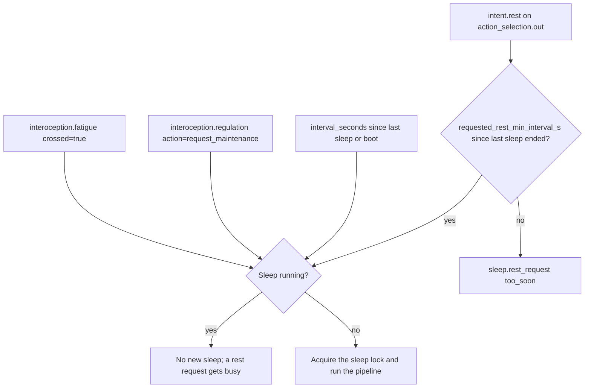

# Sleep and maintenance

The sleep module is KAINE's analog of sleep: a fatigue-triggered offline period during which the predictive processors stop adapting their forward models, and at whose end affect and drives return to baseline. This chapter explains what starts a sleep, what happens during it, each phase of the pipeline, and the events it emits. Read it if you operate, debug or change the sleep cycle. The module reference, with the configuration tables, is the [sleep module](../09-modules/sleep.md) page.

## What sleep does

A sleep runs between a `sleep.sleep.started` and a `sleep.sleep.completed` event, and the cognitive cycle keeps running through it. When a sleep starts, the sleep module switches the perceptual locus to `off` and pauses the shared stimulus playlist; when it ends, including after a failure or cancellation, it restores the pre-sleep locus and resumes the playlist from the pause point. The developmental stimulus is the exception: during the developmental phase the developmental gate holds the locus, so the stimulus keeps playing through sleep, as a fetus goes on receiving the maternal heartbeat while it sleeps. On `sleep.sleep.started`, the vision, audition, interoception and sequence modules stop updating their forward models; they keep predicting and reporting, and resume learning on `sleep.sleep.completed`. The interoception module's fatigue decays three times faster during the window. At the end the affect module's affective reset returns valence, arousal and dominance to baseline and clears the drives, and the interoception module resets its fatigue and regulation state when `sleep.sleep.completed` arrives. Because every sleep ends with that reset, arousal cannot drift across a whole run.

The consolidation phases act on memory, the world model and preference data. The base-thesis form has none of these, so in that form a sleep suspends adaptation, resets affect and drives, and resets fatigue, and the consolidation phases do no work. They begin to work when the episodic memory and world model modules join. The feed pause does not depend on them: it covers every sleep. Sleep time does not count as awake time (see [developmental phase on one host](../06-operation/development.md)).

## Fatigue

The interoception module computes fatigue from unexpected interoceptive prediction error. It learns a running expected error and spread for each channel over `expected_error_tau_s` (600 s of entity time by default), and adds to fatigue only the error above `expected + expected_error_band × spread` (`expected_error_band` = 2.0). On a hard breach, a host metric past its hard limit, the raw error is added instead. When fatigue crosses `fatigue_maintenance_threshold` (100.0), the interoception module publishes `interoception.fatigue` with `crossed = true`. See the [interoception module](../09-modules/interoception.md) for the full computation.

## What starts a sleep



There are four triggers:

- Fatigue. The sleep module watches `interoception.out` and starts a sleep when `interoception.fatigue` carries `crossed = true`.
- Maintenance request. The interoception module's regulator publishes `interoception.regulation` with `action = "request_maintenance"` on the same stream, and the sleep module starts a sleep through the same guarded path. Both of these triggers need `[sleep.consolidation].fatigue_triggered = true`, which runs the `interoception.out` consumer.
- Interval backstop. If no sleep has completed for `interval_seconds` (3600 s of entity time) since the last sleep or since boot, the scheduler starts one.
- Requested rest. An `intent.rest` on `action_selection.out`, which the action selection module's `PlanningProposalSource` issues with `origin = "planning"` when the planning module is enabled, asks for a sleep. The sleep module accepts it only when `requested_rest_min_interval_s` (1800 s) has passed since the last sleep ended and no sleep is running or starting. It answers with `sleep.rest_request` (`accepted`, and `reason` of `accepted`, `busy`, `too_soon` or `aborted`), and an accepted request's `sleep.sleep.started` carries `trigger: "requested"`.

The sleep lock stops a second sleep from starting while one runs. It blocks nothing else.

## RestScheduler

`RestScheduler` (`kaine/modules/sleep/scheduler.py`) keeps the backstop deadline on the entity clock. `is_due()` is true once the effective deadline has passed, or once the original deadline plus `max_deferral_seconds` (600 s) has passed. `try_defer()` moves the effective deadline back by `per_defer_seconds` (60 s) and returns false once the deferral budget is spent; nothing in the running system calls it outside tests. Each completed sleep schedules the next deadline `interval_seconds` ahead. A snapshot stores the time remaining, and a restore starts from it.

## The five phases

```mermaid
sequenceDiagram
    participant Sleep
    participant Bus
    participant Interoception

    Sleep->>Bus: sleep.sleep.started
    Note over Sleep: Phase 1: set_frequency(0.5); episodic_memory.consolidate_now()
    Note over Sleep: Locus off and playlist paused for the whole sleep
    Note over Sleep: Phase 2: replay in EpisodicMemory's replay window; downscale; prune
    Note over Sleep: Phase 3: cross-period traces, WorldModel, sleep.association
    Note over Sleep: Phase 4: consolidation divergence; voice-alignment gates; intent-log rotation, voice measures
    Note over Sleep: Phase 5: affect.affective_reset()
    Note over Sleep: Intent audit
    Sleep->>Bus: sleep.sleep.completed
    Bus->>Interoception: reset fatigue and regulation
```

Each phase returns a `PhaseResult` with `phase`, `success`, `elapsed_ms`, `error` and `metadata`, and catches its own errors, so the phases always run in order and a failure in one does not stop the next. Phases 1 to 4 run inside a `try` whose `finally` runs the affective reset, so a sleep that raises or is cancelled still ends with it. The reset runs as its own task behind `asyncio.shield`, so a second cancel cannot interrupt it. On any exception, including a cancel, the sleep module publishes an aborted `sleep.sleep.completed` and re-raises, so the interoception and episodic memory modules always see the sleep end.

### Phase 1: light consolidation

Phase 1 calls `set_frequency(0.5)` on every active module, a no-op unless the oscillatory layer is active, then calls `episodic_memory.consolidate_now()` to move every short-term trace into episodic memory without dropping any. Metadata: `frequency_scale`, `modules_frequency_called` and `entries_consolidated`. Without the episodic memory module it records `consolidation_skipped`.

### Phase 2: deep consolidation

Phase 2 needs the episodic memory module and otherwise returns at once with `skipped`. It opens the episodic memory module's replay window with `open_replay_window()`, runs `episodic_memory.replay_now()` while perception is already suspended for the sleep, and closes the window again with `close_replay_window()`. The replay draws on the whole wake just ended: every trace stored since the previous sleep, including the ones the wake persisted when the short-term buffer overflowed. Because the sleep module opens the window itself, the replay does not depend on the episodic memory module's bus poll having seen `sleep.sleep.started`, and nothing outside phase 2 can replay. It then calls `episodic_memory.downscale(protect=...)` with the replayed traces (paper A.10). Every other trace's strength is multiplied by `retention_per_day ** (N_new / N_day)`, so a day of storage at the resting rate leaves an unreplayed trace 82 percent of its strength, and the replayed traces keep theirs, as the synaptic homeostasis hypothesis reads reactivation in sleep (Tononi and Cirelli 2006; 2014). No vector changes. The same call then prunes: it deletes every trace below `[episodic_memory.strength].prune_floor`, then, while the stores exceed `[episodic_memory].storage_budget_bytes`, the weakest traces, the oldest first among equal strengths, never one replayed in this sleep. Nothing is deleted while awake. If replay fails, the downscaling and pruning are skipped for that sleep and the metadata records `downscale_skipped`. Metadata: `replay_events`, `replay_window_s` and `downscale`, which holds `n_new`, `factor`, `protected`, `total_before`, `total_after`, `pruned_floor`, `pruned_budget` and `store_bytes`; the sleep summary also carries the last three at top level as `memory_pruned_floor`, `memory_pruned_budget` and `memory_store_bytes`.

### Phase 3: associative replay

Phase 3 runs only when `[sleep.consolidation].associative_replay = true` and otherwise returns a successful no-op. It selects traces from at least two memory periods, drawing on the short-term buffer, the traces phase 1 consolidated and the persisted episodic store on every memory backend, cues the [world model module](../09-modules/world-model.md) to extend each into a scenario inside the scenario window that the sleep module opens before phase 2 and closes after phase 3, and publishes each scenario as a `sleep.association` event, which competes in the workspace like any other event. The [planning module](../09-modules/planning.md) and [affect module](../09-modules/affect.md) take it up through the normal cycle.

### Phase 4: voice alignment

Phase 4 first builds preference pairs from the intent-expression log and publishes the content-free `sleep.consolidation_divergence` metric. It then checks the voice-alignment gates. No validated preference source exists yet, so the phase trains nothing, even with both operator gates open. The sleep module then moves the waking intent log `state/language/intent_expression.jsonl` into the per-sleep corpus under `state/language/intent_log/`. The move never overwrites a file, and a disk check warns at 80% of `corpus_ceiling_gb` and never deletes. It computes content-free voice measures from the rotated file. See [Voice alignment](voice-alignment.md).

### Phase 5: affective reset

The sleep module ends with the affective reset (paper §3.5). Phase 5 calls `affect.affective_reset()`. It returns valence, arousal and dominance to baseline, resets every drive, sets the emotion to neutral, clears the learning-progress and alert-rate trackers, the intent rate and any perceived emotion, and publishes `affect.state` with `reset: true`. Wellness and the record of the last heard voice are kept. See the [affect module](../09-modules/affect.md#sleep-reset).

### After the phases

The sleep module runs the sleep-time intent audit (`sleep.ignition_audit`) and publishes `sleep.sleep.completed`.

## Bus events

| Event | Stream | When |
|---|---|---|
| `sleep.sleep.started` | `sleep.out` | A sleep begins; `trigger: "requested"` only for a requested rest |
| `sleep.rest_request` | `sleep.out` | Answer to a rest request |
| `sleep.association` | `sleep.out` | Each phase-3 scenario |
| `affect.state` | `affect.out` | Phase 5, with `reset: true` |
| `sleep.consolidation_divergence` | `sleep.out` | Every sleep, at the start of phase 4 |
| `sleep.ignition_audit` | `sleep.out` | Every sleep, after the phases; also merged into the completed summary |
| `sleep.sleep.completed` | `sleep.out` | The sleep ends; carries the phase results and the audit, or `{"aborted": true, "reason": ...}` if the pipeline itself aborted |
| `interoception.fatigue` | `interoception.out` | Fatigue crossed its threshold; a trigger |
| `interoception.regulation` | `interoception.out` | The regulator requests maintenance; a trigger |

## Configuration

The `[sleep]`, `[sleep.consolidation]` and `[sleep.voice_alignment]` tables are documented on the [sleep module](../09-modules/sleep.md#configuration) and [Voice alignment](voice-alignment.md#configuration) pages, and in [Perception feed and sleep](../appendix-a-configuration/perception-and-sleep.md). The interoception module's fatigue keys are in the [modules configuration page](../appendix-a-configuration/modules.md).

## Invariants

- A sleep, once started, runs every phase in order. A second sleep cannot start while one runs, and the cycle keeps ticking.
- Phase 2 always restores the perceptual locus and the playlist, even when replay fails.
- The four processors resume adaptation on `sleep.sleep.completed`, which the sleep module publishes even when the pipeline aborts.
- The intent-expression log holds rendered coalition text and generated text, with heard speech redacted, and no audio or video.

## Key files

| File | Role |
|---|---|
| `kaine/modules/sleep/module.py` | `Sleep`: triggers, pipeline, perception suspension, phase 4 |
| `kaine/modules/sleep/phases.py` | Phases 1 to 4 |
| `kaine/modules/sleep/scheduler.py` | `RestScheduler` |
| `kaine/modules/sleep/corpus.py` | Intent-log rotation and the corpus ceiling check |
| `kaine/modules/sleep/ignition_audit.py` | Sleep-time intent audit |
| `kaine/modules/interoception/module.py` | Faster fatigue decay during sleep; fatigue and regulation reset on completion |
| `kaine/modules/affect/module.py` | Affective reset |
| `kaine/modules/vision/module.py`, `kaine/modules/audition/module.py`, `kaine/modules/sequence/module.py` | Adaptation suspended between `sleep.sleep.started` and `sleep.sleep.completed` |
