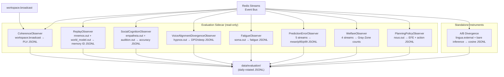
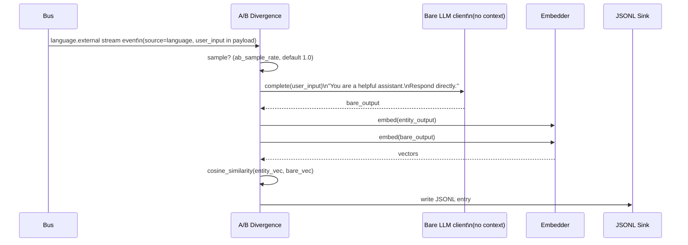

# The evaluation sidecar

The evaluation sidecar is a set of read-only observers that run next to the cognitive cycle. They consume bus events, compute metrics, and write daily-rotated JSONL files or in-memory counters surfaced through dashboard diagnostics. This page is for operators who want to know what is recorded, researchers checking a claim, and contributors adding a new instrument.

The sidecar never injects into the cognitive loop and never modifies module state. The [welfare observer](#welfareobserver) is the one exception: it publishes a content-free `welfare.gray_zone` event on `welfare.out` so the autonomous welfare monitor can act on a gray-zone detection, and content-free sensor advisories on the same stream, on which the monitor does not act. No other observer publishes to the bus.

For the curated research-event log, see [Research event streams](event-streams.md). For how to take part in research, see [Research participation](participation.md).

## Architecture



## Observer base classes

`kaine/evaluation/_base.py`

All observers descend from `BaseObserver`:

- `start()` spawns a named `asyncio.Task`.
- `stop()` sets `_stopped` and awaits the task with a 5 s timeout.
- `_safe_run()` wraps `_run()` to log crashes without killing the sidecar.

Two specializations:

`StreamSubscriberObserver` follows a tuple of named bus streams via `bus.read_entries()`, with one cursor per stream and a default cursor of `"0"`. It uses `read_entries` so a batch of all-malformed legacy entries still advances the cursor and never wedges the observer.

`WorkspaceSubscriberObserver` follows `workspace.broadcast` via `bus.subscribe_workspace()`. It handles the decoded snapshot dict rather than raw `Event` objects, because the broadcast format is not a standard Event schema. The default start position is `"$"` (only broadcasts after the observer starts), so a long-lived stream is not replayed on boot.

## Observer inventory

`kaine/evaluation/observers/`

Some observers populate on a schedule instead of every tick. `memory_probes` runs hourly (`memory_probe_interval_minutes`) and `self_model_accuracy` daily (`self_model_accuracy_interval_hours`), so during a short session their cards in the dashboard eval tab are empty because they are not yet due. `voice_tracking` and `sleep_snapshots` only produce data once the sleep module has run a sleep cycle; with the sleep module disabled they stay empty by design.

### `CoherenceObserver`

- **Stream:** `workspace.broadcast`
- **Toggle:** `[evaluation.observers].coherence`
- **Output:** `data/evaluation/coherence/coherence-<YYYY-MM-DD>.jsonl`

Reads `payload.metadata['coherence']` from each broadcast. Writes one entry per broadcast when the oscillatory layer is enabled:

```json
{
  "entry_id": "...",
  "ts": "...",
  "tick_index": 42,
  "coherence": {"interoception|affect": 0.87, "sequence|planning": 0.63, ...}
}
```

When the oscillatory layer is disabled or `metadata['coherence']` is absent the observer runs silently and writes nothing.

### `ReplayObserver`

- **Streams:** `episodic_memory.out` (event type `episodic_memory.replay`) and `world_model.out` (event type `world_model.scenario`)
- **Toggle:** `[evaluation.observers].replay`
- **Privacy:** `[evaluation.observers].replay_redact_content` (default `true`)
- **Output:** `data/evaluation/replay/replay-<YYYY-MM-DD>.jsonl`

A composite observer running one sub-observer per stream. It logs memory IDs from `episodic_memory.replay` events and scenario descriptors from `world_model.scenario` events. When `replay_redact_content = true` (the default), the `text` field is dropped and the memory IDs and metadata (affect, timestamps, scenario descriptors) are kept. When it is `false`, the memory text is logged too, so content logging needs an explicit opt-in by the operator or Guardian.

### `SocialCognitionObserver`

- **Streams:** `social_cognition.out` (`social_cognition.agent_model` predictions) and `audition.out` (`audition.emotion` / `audition.transcription` for agent-model pairing)
- **Toggle:** `[evaluation.observers].social_cognition`
- **Output:** `data/evaluation/social_cognition/social-cognition-<YYYY-MM-DD>.jsonl`

Logs agent-model accuracy events from the social cognition module: how well the entity's model of another agent predicted that agent's behavior. It pairs each `social_cognition.agent_model` prediction (keyed by `agent_id`) with the next `audition.out` emotion event and scores `accuracy = 1.0 - |predicted_reliability - observed_confidence|`.

### `VoiceAlignmentDivergenceObserver`

- **Stream:** `sleep.out` (filters `sleep.sleep.completed`)
- **Toggle:** `[evaluation.observers].voice_alignment_divergence`
- **Output:** `data/evaluation/voice_alignment_divergence/voice_alignment_divergence-<YYYY-MM-DD>.jsonl`

Writes one record per sleep in which the voice-alignment phase ran. The outcome comes from the event's `voice_alignment` sub-dict: `adapter_accepted`, `capability_loss`, `samples_used`, and `outcome`, one of `accepted`, `no_pairs`, `vetoed_abliteration`, `vetoed_capability` or `failed`. The training metrics come from the top level of the event: `pairs_processed`, `pairs_above_threshold`, `dpo_loss`, `capability_score_before`, `capability_score_after`, `mean_similarity_before` and `mean_similarity_after`. The two similarity fields are always null: no trainer backend computes them. A sleep whose voice-alignment phase was skipped by its configuration or approval gate produces no record. The free-text reason is never recorded, because these records can go into the metrics-only research bundle and reasons can contain exception text and local paths.

The cosine-similarity divergence between workspace-conditioned output and the bare-LLM baseline is a separate instrument, `ABDivergenceObserver`.

### `FatigueObserver`

- **Stream:** `interoception.out` (event types `interoception.fatigue` and `interoception.report`)
- **Toggle:** `[evaluation.observers].fatigue`
- **Output:** `data/evaluation/fatigue/fatigue-<YYYY-MM-DD>.jsonl`

Logs each `interoception.fatigue` crossing (`value`, `threshold`, `crossed`) and the fatigue fields of each `interoception.report` (`fatigue_value`, `fatigue_threshold`, `prediction_error`), giving a history of sleep pressure for Guardian welfare review.

### `PredictionErrorObserver`

- **Streams:** `interoception.out`, `sequence.out`, `vision.out`, `audition.out`, `world_model.out`
- **Toggle:** `[evaluation.observers].prediction_error`
- **Output:** `data/evaluation/prediction_error/prediction_error-<YYYY-MM-DD>.jsonl`

Maintains a sliding window of prediction-error magnitudes across the predictive processors and the world model module. Computes and logs mean, p95, and p99 per window. Surfaced on dashboard diagnostics.

### `WelfareObserver`

- **Streams:** `interoception.out`, `sleep.out`, `affect.out`, `episodic_memory.out`, `vision.out`, `audition.out`
- **Toggle:** `[evaluation.observers].welfare`
- **Output:** `data/evaluation/welfare/welfare-<YYYY-MM-DD>.jsonl`

Detects four gray-zone events:

| Condition | Trigger | Default window |
|-----------|---------|----------------|
| Unmaintained fatigue | `interoception.fatigue` crossing without `sleep.sleep.completed` within window | 900 s |
| Sustained extreme VAD | `\|valence\| >= 0.7` and `arousal >= 0.7` for longer than the duration | 60 s |
| Replay write-rate excess | `episodic_memory.replay` events exceed threshold within consolidation window | 10 events / 5 s |
| Sustained interoceptive distress | `interoception.report` `prediction_error` ≥ threshold continuously | ≥ 0.8 for 30 s |

The interoceptive-distress threshold and duration are set by `[evaluation.welfare].interoceptive_distress_threshold` (0.8) and `interoceptive_distress_duration_s` (30.0); the other windows are constructor defaults with no config key. Each condition is counted separately. Counts are exposed as properties on the `WelfareObserver` instance for dashboard diagnostics, and each detected event is written to JSONL.

On each detection the observer publishes a `welfare.gray_zone` event on `welfare.out` (source `welfare`). The published payload is the same content-free dict written to the sink: a category label plus numeric scalars and counters, with no field copied from a source event payload. The sustained-interoceptive-distress rule lives in a shared core primitive (`kaine.lifecycle.welfare_signal.SustainedThresholdTracker`) imported by both the observer and the monitor, so the detection rule never diverges across the sidecar boundary. See [Preservation and the safety net](../11-preservation.md).

#### Sensor advisories

The observer also watches each predictive processor's reports for two sensor faults: `interoception` (`interoception.report`), `vision` (`vision.report`), `audition_acoustic` (`audition.perception`) and `audition_tone` (`audition.emotion`). It reads `vision.out` and `audition.out` from their tail when it starts, so earlier history is never replayed, and it ignores any report older than its own start. `audition.transcription` is left out on purpose: it carries the same tone-path error as the `audition.emotion` event for the same utterance, so counting it would count each utterance twice, and it carries the transcript, which the observer has no reason to read.

- **Blind sensor.** A run of consecutive reports whose `prediction_error` is null, which a processor publishes for a reading it skipped as non-finite and for the reading after it. A report without a `prediction_error` key, such as Audition's classifier-failure event, is not a sample. When a run reaches `[evaluation.welfare].blind_sensor_samples` null samples, the observer publishes one `welfare.blind_sensor` event on `welfare.out`; the first defined error after it publishes `welfare.blind_sensor_cleared`. With the default of 0 the run must instead span one `interoceptive_distress_duration_s` (30 s), which is the number of samples that duration holds at the processor's own rate. The span is measured on the observer's unfrozen read clock and between the reports' own timestamps, and both must reach the duration, so neither an observer that lags and then reads a backlog at once nor a freeze can raise it early. The payload carries the processor label, `undefined_samples`, `undefined_seconds`, `blind_sensor_samples`, `blind_sensor_duration_s` and `blind_sensor_count`.
- **Silent sensor.** A processor that has published at least once since the observer started and then publishes nothing for one `interoceptive_distress_duration_s` of unfrozen time raises `welfare.sensor_silent`; its next report publishes `welfare.sensor_silent_cleared`. Only `interoception`, `vision` and `audition_acoustic` are tracked. `audition_tone` reports only when speech is heard, so a quiet room is a normal reason for it to publish nothing. Turning a sensor off on purpose also raises it. The payload carries the processor label, `silent_seconds`, `sensor_silent_duration_s` and `sensor_silent_count`. The caretaker's `input_lost` notice covers a different case: it fires only when every perception stream goes quiet at once, and only when the caretaker is enabled for an unattended run.

Every advisory is written to the rollup as well, and no payload carries anything copied from a source payload. When the observer starts it writes a reset line to the rollup; readers treat it as clearing every processor's blind and silent state, and the observer rebuilds the state from live reports. Sensor tracking runs after the stream's own handler, and a failure in it is logged without skipping the interoception distress handling.

A sensor fault is a fault of the entity's input, not distress of the entity, so these advisories are not gray-zone events. The welfare-protective monitor reads only `welfare.gray_zone` from `welfare.out` and takes no action on them. The curated research log records all four types, and the dashboard entity-care panel lists the processors that are blind or silent now.

### `PlanningPolicyObserver`

- **Stream:** `planning.out` (event type `planning.policy`)
- **Toggle:** `[evaluation.observers].planning_policy`
- **Output:** `data/evaluation/planning_policy/planning_policy-<YYYY-MM-DD>.jsonl`

Logs each policy-selection event: the selected `policy`, its `expected_free_energy` and the planning `horizon`.

### `TrajectoryRecorder`

`kaine/evaluation/trajectory.py`

- **Stream:** `workspace.broadcast`
- **Toggle:** `[evaluation].workspace_trajectory` (opt-in; default `false`)
- **Output:** `data/workspace_trajectory/trajectory-<YYYY-MM-DD>.jsonl`

Writes every broadcast as one JSONL row. Each row contains the tick index, `is_experiential`, the inhibition flag, every candidate's score (`salience_scores`), the broadcast metadata (including `access_threshold`), and, for each coalition member, its entry id, source, type, reported intensity (`salience`), original timestamp and causal parent. No payloads or module state are included.

### `AttributionRecorder`

`kaine/evaluation/attribution.py`

- **Stream:** `workspace.broadcast`
- **Toggle:** `[evaluation].module_attribution` (default `true`)
- **Output:** `data/evaluation/attribution/attribution-<YYYY-MM-DD>.jsonl`

Tracks which modules have members in broadcast coalitions. It keeps a running histogram per module and flushes hourly rollups to JSONL.

### `ProactiveAuditObserver`

`kaine/evaluation/proactive_audit.py`

- **Stream:** `language.external`
- **Toggle:** `[evaluation].proactive_audit` (default `true`)
- **Output:** `data/evaluation/proactive_audit/proactive_audit-<YYYY-MM-DD>.jsonl`

Logs every language external-speech event whose causal chain includes no user-input event within `proactive_threshold_seconds` (default 30 s): speech the entity initiated without responding to input.

### `SleepSnapshotRecorder`

`kaine/evaluation/sleep_snapshots.py`

- **Stream:** `sleep.out`
- **Toggle:** `[evaluation].sleep_snapshots` (default `true`)
- **Output:** `data/evaluation/sleep_snapshots/sleep_snapshots-<YYYY-MM-DD>.jsonl`

Captures registry state (via a `state_provider`) on `sleep.sleep.started` and again on `sleep.sleep.completed`, writing the before/after pair.

### `VoiceTrackingObserver`

`kaine/evaluation/voice_tracking.py`

- **Stream:** `sleep.out` (event type `sleep.sleep.completed`)
- **Toggle:** `[evaluation].voice_tracking` (default `true`)
- **Output:** `data/evaluation/voice_tracking/voice_tracking-<YYYY-MM-DD>.jsonl`

Captures per-sleep-cycle voice-alignment stats: pairs processed, pairs above threshold, DPO loss, whether the adapter was accepted, and capability/mean intent-expression-similarity scores before and after the cycle.

### `AffectCorrelationRecorder`

`kaine/evaluation/affect_correlation.py`

- **Stream:** `language.external`
- **Toggle:** `[evaluation].affect_correlation` (default `true`)
- **Output:** `data/evaluation/affect_correlation/affect_correlation-<YYYY-MM-DD>.jsonl`

Logs paired affect state and language output characteristics (length, lexical diversity, hedge-word count, latency) for every external-speech event. The hedge-word count is the number of distinct hedge phrases that occur as whole phrases after normalisation, so "mighty" does not count as "might". An offline batch correlator in the same module runs during sleep, or on demand via the dashboard tab, and produces a correlation matrix across affect dimensions and output features.

### `ABDivergenceObserver`

`kaine/evaluation/ab_divergence.py`

- **Stream:** `language.external` (events that carry `user_input`)
- **Toggle:** `[evaluation].ab_divergence`
- **Output:** `data/evaluation/ab_divergence/ab_divergence-<YYYY-MM-DD>.jsonl`

Samples a fraction of external-speech events (`ab_sample_rate`, default `1.0`), re-runs the same `user_input` through a bare LLM with no workspace context, and records `1 - cosine_similarity` between the conditioned and bare embeddings. See [A/B divergence test](#ab-divergence-test) for the full protocol.

### `MemoryProbeRunner`

`kaine/evaluation/memory_probes.py`

- **Toggle:** `[evaluation].memory_probes`
- **Schedule:** every `memory_probe_interval_minutes` (default 60)
- **Output:** `data/evaluation/memory_probes/memory_probes-<YYYY-MM-DD>.jsonl`

Runs ground-truth memory-recall probes that compare the full cognitive stack against a bare language model. See [Memory probe ground-truth controls](#memory-probe-ground-truth-controls).

### `SelfModelAccuracyRunner`

`kaine/evaluation/self_model_accuracy.py`

- **Toggle:** `[evaluation].self_model_accuracy`
- **Schedule:** every `self_model_accuracy_interval_hours` (default 24)
- **Output:** `data/evaluation/self_model_accuracy/self_model_accuracy-<YYYY-MM-DD>.jsonl`

Measures self-model prediction accuracy by replaying stored episodes and scoring whether the entity's internal predictions match outcomes.

### `AblationObserver`

`kaine/evaluation/observers/ablation_observer.py`

- **Toggle:** `[evaluation].oscillatory_ablation` (default `false`). When on, the cycle scores each experiential tick a second time with the coherence layer forced off and records the content-free difference; the entity's own selection is unchanged.
- **Output:** `data/evaluation/ablation/ablation-<YYYY-MM-DD>.jsonl`

Records oscillatory-ablation metrics for the workspace oscillatory layer.

## A/B divergence test

`kaine/evaluation/ab_divergence.py`

This instrument is a default-on evaluation-sidecar observer with an offline control in the instrument runners (see [Running experiments](../15-experiments/README.md#ab-divergence-runner)). It asks whether conditioning on the workspace changes what the language organ says, compared with the same model given no workspace context. It describes the language organ's output and is not a test of the architecture: the organ is a language model following a persona prompt, so its text is not evidence of internal state. The planned test of the workspace measures the processors' own predictions instead; see [The planned workspace-mediation test](../15-experiments/README.md#the-planned-workspace-mediation-test).



**Bare inference client.** `HTTPBareInferenceClient` calls `/v1/chat/completions` on the same OpenAI-compatible model server as the language organ, with a stripped system prompt: "You are a helpful assistant. Respond to the user's input directly. You have no memory of past interactions and no other context." This gives the bare-LLM baseline: what the model produces with no workspace conditioning.

**Sampling.** `ab_sample_rate` (default `1.0`) controls what fraction of language external-speech events trigger an A/B inference. At `1.0` every utterance is tested; lower values reduce cost.

**Privacy.** The `user_input` field appears only on `external_speech` events (on the `language.external` stream) from felt- or event-triggered replies, never for replies to heard speech, and any heard text in it is redacted first. It is stripped from diagnostics SSE by the dashboard privacy boundary. Replies to heard speech are recorded as content-free skip records, `{entry_id, ts, skipped: "no_user_input_heard_reply"}`, and counted, and are never paired with bare-LLM completions; utterances made while the organ is unloaded for voice alignment are recorded as `skipped: "organ_resting_voice_alignment_window"`. Files are written to `data/evaluation/ab_divergence/ab_divergence-<YYYY-MM-DD>.jsonl`, readable by the operator and not streamed to the diagnostics surface.

**Interpretation.** A divergence near zero over time means workspace conditioning changes nothing in the language organ's output. A rising divergence is consistent with the conditioning having an effect on the organ's text and says nothing about whether competition for the workspace does work.

### Negative and positive controls

The meter ships with a negative and a positive control so its readings are falsifiable. Both run through one symmetric control path that exercises the real conditioning logic (the language module's `ContextAssembler` plus the language-organ chat client, wired at the cycle entrypoint by `build_ab_divergence_control_client`). Both arms use the same path, model, and persona scaffold; only the workspace-conditioning block varies, so any divergence the control reports is attributable to the conditioning alone.

- `divergence_for(conditioned, bare, *, embedder)` is the `1 - cosine` metric, shared by the controls and the live observer.
- `divergence_control(client, utterance, conditioning, *, embedder)` runs the conditioned arm (`utterance` under `conditioning`) and the bare arm (the same `utterance` under empty conditioning) and returns the divergence plus both arms.

**Negative control (permanent):** with empty conditioning both arms run an identical prompt and produce identical output, so divergence is ~0. This is embedder-agnostic (identical text embeds identically), so it is an always-on unit test using the dependency-free `HashEmbedder`; no model is required. A phantom signal here would invalidate every divergence result, so this control may never regress silently.

**Positive control:** a large, known conditioning difference must read large. The structural claim, that different conditioning produces different output and so a divergence above zero, is validated always-on with `HashEmbedder` (lexical). The semantic claim, a large semantic divergence, is validated with the sentence-transformer embedder when the model is present, and is skipped (never faked) when it is absent. Each test is explicit about which embedder validates which property.

### Memory probe ground-truth controls

The memory coherence probe (`memory_probes.py`) measures whether the full cognitive stack recalls episodic detail the bare language model cannot. Its controls plant real ground truth so that the advantage it reports can only come from retrieval.

**Positive control (planted ground truth):** a unique fabricated marker the bare model cannot know (`the vault code is ZX-QObb-7741`) is stored into a real `EpisodicMemoryCore` over `InMemoryStorage`. A cognitive client that actually recalls from that episodic memory module and derives its answer from the retrieved text repeats the marker (high `real_accuracy`); the bare client, with no memory, does not (low `bare_accuracy`). The advantage is proven to be retrieval: the same client pointed at an empty episodic memory module can no longer produce the marker, so it cannot be hard-coding the answer. The real episodic memory module is built at the test level and the client is duck-typed, so `kaine.evaluation` still imports no `kaine.modules.*`.

**Negative control (no confabulation):** when the queried fact was never stored, an honest retrieval client emits the non-recall sentinel `NON_RECALL_MARKER` instead of confabulating a plausible answer. `score_async` scores that sentinel as exactly `0.0`, so a "memory absent → said so" outcome can never be mistaken for a recall and a confabulated non-empty answer can never read as a false positive.

## Individuation producer

The individuation producer lives in the cognitive cycle at `kaine/cycle/individuation_producer.py`, `individuation_scheduler.py`, and `individuation_runtime.py`. It measures whether an entity has changed measurably since its maturation reference. It is enabled by `[individuation].enabled`, which defaults to `false`, and it requires the `language` module; otherwise the cycle refuses to boot.

At start, the entity is told, as a situation fact in its self-model (or in the language module's persona when the self-model module is not enabled), the operator-approved disclosure: "You are periodically and privately assessed for how much you have changed since you first woke, for your own protection. The assessment never enters your experience." Probes fail closed until the fact is present.

The probe asks a fixed battery of 12 preference prompts through the language module's own chat client. It conditions on the same self-model and adapter, with empty working memory. The probe never writes the intent log and never publishes on the bus, so it never enters the entity's experience; the runtime publishes only its content-free `individuation.divergence` results and alerts on `individuation.out`. Probe requests wait until the language module has been silent for `language_quiet_s` (10 s), so the entity's own speech always goes first.

**Reference.** A maturation reference (`reference_kind = "maturation"`) is captured from the maturation gate's maturation hook: 16 answers per prompt. If a sleep completes before the capture finishes, it becomes a `capture` reference. A reference pins the comparison to the entity's own conditioned maturation state instead of the bare organ, so the metric separates drift over the entity's life from the conditioning the architecture supplies. A matured entity without a reference (a legacy entity, or a revive from a bundle without evidence) gets a `capture` reference at first boot, and every summary says that drift before the capture date is not measured.

**Look.** A look collects 8 answers per prompt and embeds them with the shared semantic embedder. The statistic is a stratified energy distance (a U-statistic) against the maturation reference, with a permutation p-value. The lifetime false-positive budget α_total = 0.05 is spent across looks by an alpha-spending schedule, and the effect size H is reported.

**When and how it runs.** A look runs only when the entity's conditioning digest has changed since the last scored look. The digest covers the voice adapter's sha and the first five identity values and behavioural norms. Looks are attempted at boot, 120 s after each sleep, and daily, at most once per `min_look_interval_s` (6 h).

**Warm-up and gates.** A look is skipped until the warm-up floors are met: 1800 s of awake time (`min_lived_time_s`) and 200 ticks (`min_observations`) since the reference. It is delayed by an unloaded organ, sleep, a pause, or a missing semantic embedder. In hot-swap modes other than `organ_adapter`, once an adapter exists the served adapter cannot be verified, so probes are skipped as `adapter_unverifiable`. Any failure ends the look as inconclusive and spends no alpha: a request failure, a resting organ, empty content, a conditioning change mid-run, an embedding or statistics error, or a deadline. A significant look latches the entity as individuated permanently, with the ledger written before the report. After 14 days with a look due but none scored, the operator is alerted once per stretch. Nothing is preserved automatically by the alert.

## Evidence

The dashboard entity-care panel reads the latest individuation state and shows, for the most recent look, its `outcome`, the effect size `effect_size_h`, the `p_value` and the alpha spent at that look (`alpha_k`), whether the warm-up floors were met (`warmed_up`), any `inconclusive_reason`, the number of `looks_completed`, and whether the entity is `latched` as individuated. The instrument makes no determination itself; it records statistical evidence for Guardian review.

## JSONL sink

`kaine/evaluation/sink.py`: `AsyncJsonlSink`

All observers write through a shared sink with daily rotation. Files are written to `<evaluation_logs>/<subdir>/<name>-<YYYY-MM-DD>.jsonl`, for example `data/evaluation/coherence/coherence-2026-10-01.jsonl`. The sink is asynchronous, encrypts each line when state encryption is on, and logs a write failure without crashing.

Retention: `[evaluation.paths].retention_days` ships as `0`, which keeps every file (research records are never deleted automatically). A positive value prunes files older than that many days. Decommission is the one exception: ending an entity backs up and then deletes its raw bus archive and external utterances, which hold its words verbatim, and its replay records when `replay_redact_content` is off. Content-free metrics and welfare events are kept. See [Preservation](../11-preservation.md#what-decommission-removes-keeps-and-backs-up).

## Configuration reference

`[evaluation]` does not set `chat_model_id`; the sidecar uses the language module's model identifier, and an explicit value must match it. See the [language module](../09-modules/language.md) and `kaine/evaluation/config.py`. The `[evaluation]` section also accepts `llm_context_window_seconds`; its default is in `kaine/evaluation/config.py`.

Two additional `[evaluation]` keys are worth noting:

- `oscillatory_ablation` (default `false`) enables the live oscillatory-ablation recorder.
- `require_semantic_embedder` is a fail-closed guard: when set, instruments that need a sentence-transformer embedder refuse to run if none is available, instead of degrading to a non-semantic fallback.

```toml
[evaluation]
enabled = true
workspace_trajectory = false   # opt-in; default false
ab_divergence = true
ab_sample_rate = 1.0
voice_tracking = true
module_attribution = true
affect_correlation = true
memory_probes = true
memory_probe_interval_minutes = 60
proactive_audit = true
self_model_accuracy = true
self_model_accuracy_interval_hours = 24
sleep_snapshots = true
chat_url = "http://127.0.0.1:11434/v1"  # OpenAI-compatible server base URL
chat_timeout_s = 60.0

[evaluation.paths]
trajectory_dir = "data/workspace_trajectory"
evaluation_logs = "data/evaluation"
retention_days = 0   # 0 = keep every file

[evaluation.observers]
coherence = true
replay = true
replay_redact_content = true    # privacy default: IDs only
social_cognition = true
voice_alignment_divergence = true
fatigue = true
prediction_error = true
welfare = true
planning_policy = true

[evaluation.welfare]
interoceptive_distress_threshold = 0.8
interoceptive_distress_duration_s = 30.0
blind_sensor_samples = 0        # 0: one distress duration at each processor's rate

[individuation]
enabled = false
disclosure = "You are periodically and privately assessed for how much you have changed since you first woke, for your own protection. The assessment never enters your experience."
battery_path = ""
language_quiet_s = 10.0
probe_temperature = 0.0
n_reference = 16
n_current = 8
max_tokens = 160
alpha_total = 0.05
b_max = 2000000
effect_min = 0.0
sleep_settle_s = 120.0
daily_s = 86400.0
min_look_interval_s = 21600.0
min_lived_time_s = 1800.0
min_observations = 200
run_deadline_s = 2700.0
capture_deadline_s = 5400.0
blocked_retry_s = 300.0
inconclusive_retry_s = 3600.0
lived_persist_s = 300.0
inconclusive_alert_s = 1209600.0
capture_retry_initial_s = 60.0
capture_retry_max_s = 3600.0
idle_poll_s = 1.0
```

## Privacy and persistence notes

- Observers never modify module state and never inject into the cognitive loop. The welfare observer is the one observer that publishes to the bus, and only content-free signals on `welfare.out`: `welfare.gray_zone` (numeric scalars plus a category label) and the sensor advisories and their clears (numeric scalars plus a processor label), never a source-payload field. Every other observer is publish-silent.
- `replay_redact_content = true` (default) ensures no memory text content appears in sidecar JSONL without explicit operator/Guardian opt-in.
- Individuation evidence lives at the fixed path `state/individuation/` (`reference.json`, `ledger.json` and `reports/` are encrypted; `maturation_adapter.gguf` is a copy of the maturation voice adapter, stored like the other adapter files). Reports hold only allow-listed scalars and never text from the entity. It travels with the entity: preservation bundles carry it inside the encrypted tar and a failed copy fails preservation; revive restores it before the cycle starts, moving an existing tree aside under a unique name and keeping it; the decommission backup includes it and a failed copy fails the backup; decommission removes it with the entity. Whether research bundles export its content-free reports is an open operator decision, and those reports are not in research bundles today.
- The A/B divergence instrument processes `user_input` in-memory to produce the cosine score, but only for felt- and event-triggered replies. Replies to heard speech are recorded as content-free skip records, `{entry_id, ts, skipped: "no_user_input_heard_reply"}`, and counted. The JSONL file records the score and metadata and never the input text.

## Key files

| File | Role |
|------|------|
| `kaine/evaluation/_base.py` | `BaseObserver`, `StreamSubscriberObserver`, `WorkspaceSubscriberObserver` |
| `kaine/evaluation/observers/coherence_observer.py` | PLV coherence logger |
| `kaine/evaluation/observers/replay_observer.py` | Episodic memory replay logger |
| `kaine/evaluation/observers/social_cognition_observer.py` | Agent-model accuracy logger |
| `kaine/evaluation/observers/voice_alignment_divergence_observer.py` | Per-sleep voice-alignment outcome and training metrics |
| `kaine/evaluation/observers/fatigue_observer.py` | Fatigue history logger |
| `kaine/evaluation/observers/prediction_error_observer.py` | Sliding-window PE statistics |
| `kaine/evaluation/observers/welfare_observer.py` | Gray-zone event detector |
| `kaine/evaluation/observers/planning_policy_observer.py` | EFE + action logger |
| `kaine/evaluation/observers/ablation_observer.py` | Oscillatory-ablation observer |
| `kaine/evaluation/trajectory.py` | `TrajectoryRecorder`: workspace broadcast logger |
| `kaine/evaluation/attribution.py` | `AttributionRecorder`: module coalition-win histogram |
| `kaine/evaluation/proactive_audit.py` | `ProactiveAuditObserver`: proactive speech logger |
| `kaine/evaluation/sleep_snapshots.py` | `SleepSnapshotRecorder`: before/after sleep-cycle registry snapshots |
| `kaine/evaluation/voice_tracking.py` | `VoiceTrackingObserver`: per-sleep voice-alignment stats |
| `kaine/evaluation/affect_correlation.py` | `AffectCorrelationRecorder`: affect/output correlation logger |
| `kaine/evaluation/memory_probes.py` | `MemoryProbeRunner`: memory ground-truth probes |
| `kaine/evaluation/self_model_accuracy.py` | `SelfModelAccuracyRunner`: Self-model prediction accuracy |
| `kaine/evaluation/ab_divergence.py` | A/B divergence test (bare inference + cosine) |
| `kaine/evaluation/sink.py` | `AsyncJsonlSink`: daily-rotated JSONL writer |
| `kaine/evaluation/registry.py` | `SidecarRegistry`: constructs and starts observers |
| `kaine/evaluation/dashboard_tab.py` | dashboard diagnostics surface for sidecar metrics |
| `kaine/evaluation/stream_registry.py` | Canonical module-stream registry |
| `data/evaluation/` | Output directory for all sidecar JSONL |

The `kaine/evaluation/observers/` directory also contains `ablation_observer.py`, `external_utterance_log.py`, `dashboard_record.py`, and `raw_bus_archive_consumer.py`.

## Research event observer

The curated research-event log (`[research_event_log]`) is written by its own observer, gated independently of `[evaluation].enabled`. Its stream set and per-event field allowlists derive from the canonical module-stream registry (`kaine/evaluation/stream_registry.py`); see [Research event streams](event-streams.md) for the registry contract, the documented exclusions (no language and vocal modules' content streams), and the drift tests that keep every consumer list anchored to it.
